.. _gallery:

Gallery
=======

The examples below are fully reproducible and the accompanying images are
committed under ``docs/_static/gallery/``. They are generated from the same
public API you would use in your own analysis.

.. grid:: 1 2 3 3
   :gutter: 3

   .. grid-item-card:: Linear fit with residuals
      :link: gallery-linear
      :link-type: ref
      :img-top: _static/gallery/linear_fit.png

      Core least-squares workflow with 1-σ uncertainties and residual analysis.

   .. grid-item-card:: Customising a fit plot
      :link: gallery-plot-customisation
      :link-type: ref
      :img-top: _static/gallery/plot_customisation.png
      :img-alt: Open teal diamonds with error bars, a dashed orange fit line, and a framed legend

      Change marker shapes, colours, line styles and the legend after plotting.

   .. grid-item-card:: Gaussian peak fit
      :link: gallery-gaussian
      :link-type: ref
      :img-top: _static/gallery/gaussian_fit.png

      Built-in Gaussian model with automated initial guess heuristics.

   .. grid-item-card:: Multi-series comparison
      :link: gallery-damped-oscillators
      :link-type: ref
      :img-top: _static/gallery/damped_oscillators.png

      Overlay both trials’ measurements and fitted curves on shared axes.

   .. grid-item-card:: Bimodal Gaussian peaks
      :link: gallery-bimodal-gaussian
      :link-type: ref
      :img-top: _static/gallery/bimodal_gaussian.png

      Multi-peak deconvolution with bounds and parameter constraints.

   .. grid-item-card:: Exponential decay
      :link: gallery-exponential-decay
      :link-type: ref
      :img-top: _static/gallery/exponential_fit.png

      Counting-statistics decay fitting with per-point error weighting.

   .. grid-item-card:: Domain subset fitting
      :link: gallery-subset-fit
      :link-type: ref
      :img-top: _static/gallery/subset_fit.png

      Isolate and fit specific regions of interest while preserving full-range data.

   .. grid-item-card:: Model comparison
      :link: gallery-model-comparison
      :link-type: ref
      :img-top: _static/gallery/model_comparison.png

      Side-by-side reduced χ² comparison between competing physics models.

   .. grid-item-card:: Confidence & prediction bands
      :link: gallery-confidence-bands
      :link-type: ref
      :img-top: _static/gallery/confidence_band.png

      95 % mean-response and future-observation confidence bounds.

   .. grid-item-card:: Error propagation
      :link: gallery-error-propagation
      :link-type: ref
      :img-top: _static/gallery/error_propagation.png

      Propagate fitted parameter covariances into derived physical quantities.

   .. grid-item-card:: Peak with sloping background
      :link: gallery-spectral-peak
      :link-type: ref
      :img-top: _static/gallery/gaussian_baseline.png

      Combined signal plus linear background fit with automated baseline estimation.

   .. grid-item-card:: Correlated errors (GLS)
      :link: gallery-gls
      :link-type: ref
      :img-top: _static/gallery/generalized_least_squares.png

      Generalized least squares using full covariance matrices for correlated noise.

----

.. _gallery-linear:

Linear fit with residuals
-------------------------

This example shows the core least-squares flow from raw arrays to a fit result
with uncertainties and residuals.

.. code-block:: python

   import numpy as np
   from labfit import fit_curve, plot_fit

   rng = np.random.default_rng(20240606)
   x = np.linspace(0.0, 8.0, 30)
   sigma = 0.10 + 0.02 * (1.0 + np.sin(x))
   y = 1.85 * x - 0.65 + rng.normal(0.0, sigma)

   result = fit_curve("linear", x, y, sigma)
   plot = plot_fit(result, show_residuals=True, title="Linear fit with residuals")
   plot.save("docs/_static/gallery/linear_fit.png")

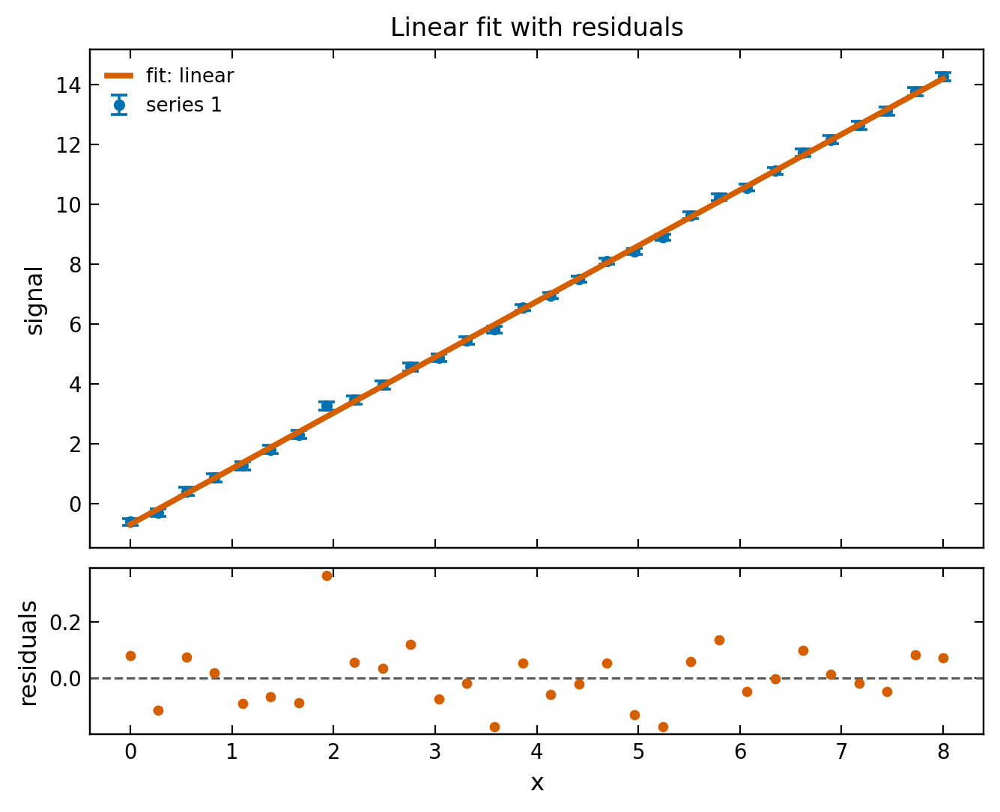

   Least-squares line fit with a residual panel underneath.

Linear fit console output
~~~~~~~~~~~~~~~~~~~~~~~~~

.. code-block:: console

   slope = 1.860589 ± 0.008830
   intercept = -0.694920 ± 0.041056
   reduced chi^2 = 0.788588

.. _gallery-plot-customisation:

Customising a fit plot
----------------------

With ``show_residuals=False``, ``plot.axes`` is the Matplotlib axes for the
fit. Find the artists by their legend labels, then use Matplotlib's setters
to change how the measurements and fitted line look. Set the top and right
spines visible to restore those edges of the plot. Rebuild the legend after
editing the artists so it shows the updated styles.

.. code-block:: python

   import numpy as np
   from labfit import fit_curve, plot_fit

   rng = np.random.default_rng(20240606)
   x = np.linspace(0.0, 8.0, 30)
   sigma = 0.10 + 0.02 * (1.0 + np.sin(x))
   y = 1.85 * x - 0.65 + rng.normal(0.0, sigma)

   result = fit_curve("linear", x, y, sigma, label="Measurements")
   plot = plot_fit(
       result, show_residuals=False, title="Customised linear fit",
       xlabel="x", ylabel="Signal",
   )
   ax = plot.axes
   handles, labels = ax.get_legend_handles_labels()
   artists = dict(zip(labels, handles))

   # The measurement handle contains the markers, caps and error bars.
   markers, caps, bars = artists["Measurements"].lines
   teal = "#00796b"
   markers.set(marker="D", markerfacecolor="none", markeredgecolor=teal)
   for cap in caps:
       cap.set_markeredgecolor(teal)
   for bar in bars:
       bar.set_color(teal)

   artists["fit: linear"].set(color="#c45100", linestyle="--", linewidth=2)
   ax.spines["top"].set_visible(True)
   ax.spines["right"].set_visible(True)
   ax.legend(title="Linear fit", loc="upper left", frameon=True)
   plot.save("plot_customisation.png")

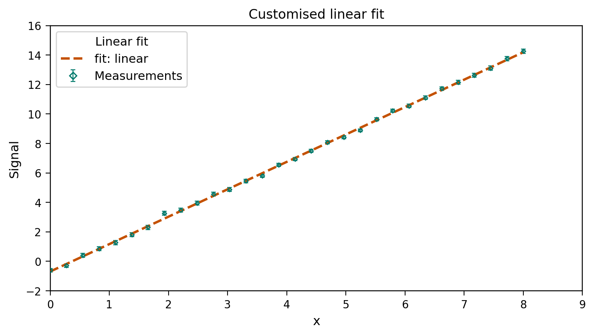

   The same linear fit with open diamond markers, a dashed fit line, a
   framed legend and visible top and right spines.

.. _gallery-gaussian:

Gaussian fit
------------

This example uses the built-in Gaussian model with automatic initial guesses.

.. code-block:: python

   import numpy as np
   from labfit import fit, plot_fit

   rng = np.random.default_rng(20240607)
   x = np.linspace(-5.0, 5.0, 260)
   y = 4.0 * np.exp(-0.5 * ((x - 0.75) / 1.10) ** 2) + 0.18
   y = y + rng.normal(0.0, 0.08, size=x.size)

   result = fit(x, y, model="gaussian")
   plot = plot_fit(result, show_residuals=True, title="Gaussian fit")
   plot.save("docs/_static/gallery/gaussian_fit.png")

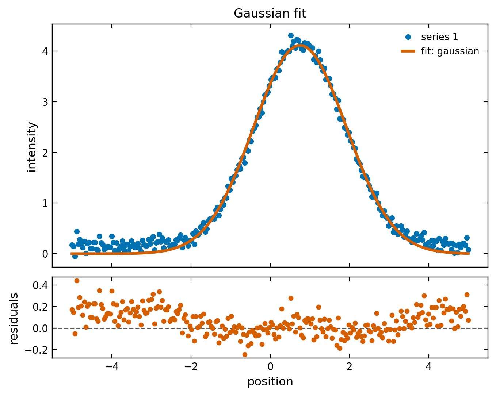

   A standard Gaussian fit using the built-in model and automatic initial guess.

Gaussian fit console output
~~~~~~~~~~~~~~~~~~~~~~~~~~~

.. code-block:: console

   amplitude = 4.1157361 ± 0.0221282
   mean = 0.7529858 ± 0.0072789
   sigma = 1.1724581 ± 0.0072790
   reduced chi^2 = 0.0175698

.. _gallery-damped-oscillators:

Multi-series damped oscillator comparison
-----------------------------------------

Fit two experimental series with :meth:`labfit.Fitter.fit_multi`, then use
``labfit.plot.plot_result`` to overlay the measurements and fitted curves
on shared time and signal axes.

.. code-block:: python

   import numpy as np
   from labfit import Fitter, Series
   from labfit.plot import plot_result

   def damped_oscillator(t, amplitude, damping, f, phase):
       return amplitude * np.exp(-damping * t) * np.cos(2.0 * np.pi * f * t + phase)

   rng = np.random.default_rng(20240608)
   x1 = np.linspace(0.0, 6.0, 240)
   x2 = np.linspace(0.0, 6.0, 220)
   s1 = Series(x=x1, y=damped_oscillator(x1, 1.25, 0.22, 0.98, 0.10) + rng.normal(0, 0.03, size=x1.size), sigma=0.03, label="Trial 1")
   s2 = Series(x=x2, y=damped_oscillator(x2, 1.05, 0.18, 1.02, -0.05) + rng.normal(0, 0.03, size=x2.size), sigma=0.03, label="Trial 2")

   fitter = Fitter(model=damped_oscillator, p0={"amplitude": 1.0, "damping": 0.2, "f": 1.0, "phase": 0.0})
   results = fitter.fit_multi([s1, s2])
   plot = plot_result(results, title="Damped oscillator comparison", xlabel="time / s", ylabel="signal")
   plot.save("docs/_static/gallery/damped_oscillators.png")

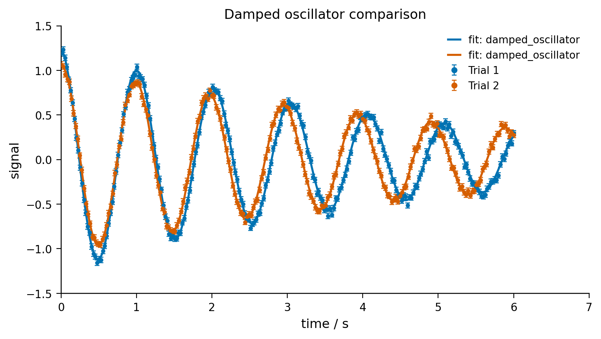

   Measurements and fitted curves for Trial 1 and Trial 2 on the same axes.

Damped oscillator console output
~~~~~~~~~~~~~~~~~~~~~~~~~~~~~~~~

.. code-block:: console

   Trial 1
     amplitude = 1.244714 ± 0.007525
     damping = 0.219231 ± 0.002599
     f = 0.980064 ± 0.000407
     phase = 0.096056 ± 0.006038
     reduced chi^2 = 1.065382
   Trial 2
     amplitude = 1.051220 ± 0.006845
     damping = 0.183296 ± 0.002583
     f = 1.019614 ± 0.000429
     phase = -0.049326 ± 0.006753
     reduced chi^2 = 0.914054

.. _gallery-bimodal-gaussian:

Bimodal Gaussian fit
--------------------

This example fits a sum of two Gaussian peaks using the built-in
``bimodal_gaussian`` model.

.. code-block:: python

   import numpy as np
   from labfit import fit, plot_fit

   rng = np.random.default_rng(20260607)
   x = np.linspace(-6.0, 10.0, 300)
   y = (
       3.5 * np.exp(-0.5 * ((x - 0.0) / 0.9) ** 2)
       + 2.0 * np.exp(-0.5 * ((x - 4.5) / 1.2) ** 2)
       + rng.normal(0.0, 0.06, size=x.size)
   )

   result = fit(
       x, y, model="bimodal_gaussian",
       p0={"amplitude1": 3.0, "mean1": 0.0, "sigma1": 1.0,
           "amplitude2": 1.5, "mean2": 4.0, "sigma2": 1.0},
   )
   plot = plot_fit(result, show_residuals=True,
                   title="Bimodal Gaussian fit")
   plot.save("docs/_static/gallery/bimodal_gaussian.png")

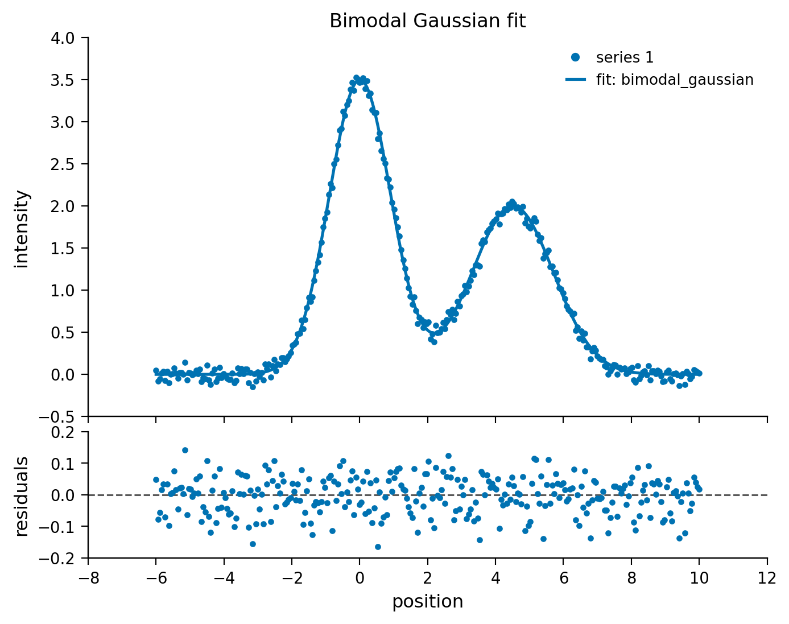

   A two-peak Gaussian model fitted to synthetic data showing the
   fit curve and residuals.

Bimodal Gaussian fit console output
~~~~~~~~~~~~~~~~~~~~~~~~~~~~~~~~~~~~

.. code-block:: console

   amplitude1 = 3.498592 ± 0.013417
   mean1 = 0.003859 ± 0.004059
   sigma1 = 0.902587 ± 0.004157
   amplitude2 = 1.999901 ± 0.011716
   mean2 = 4.508767 ± 0.008134
   sigma2 = 1.195551 ± 0.008429
   reduced chi^2 = 0.003556

.. _gallery-exponential-decay:

Exponential decay with per-point errors
----------------------------------------

This example fits an exponential decay where every data point has its own
y-uncertainty passed as an array. This is typical of counting-statistics
experiments (radioactive decay, photon counts, etc.) where σ ∝ √(counts).

.. code-block:: python

   import numpy as np
   from labfit import fit_curve, plot_fit

   rng = np.random.default_rng(20260608)
   x = np.linspace(0.0, 10.0, 40)

   # True model: 5.0 * exp(-0.4 * x)
   y_true = 5.0 * np.exp(-0.4 * x)

   # Per-point uncertainties vary across the dataset
   sigma = 0.05 + 0.08 * np.sqrt(y_true)
   y = y_true + rng.normal(0.0, sigma)

   result = fit_curve("exponential", x, y, sigma,
                      p0={"amplitude": 5.0, "decay": 0.5})
   plot = plot_fit(result, show_residuals=True,
                   title="Exponential decay with per-point errors",
                   xlabel="time / s", ylabel="signal")
   plot.save("docs/_static/gallery/exponential_fit.png")

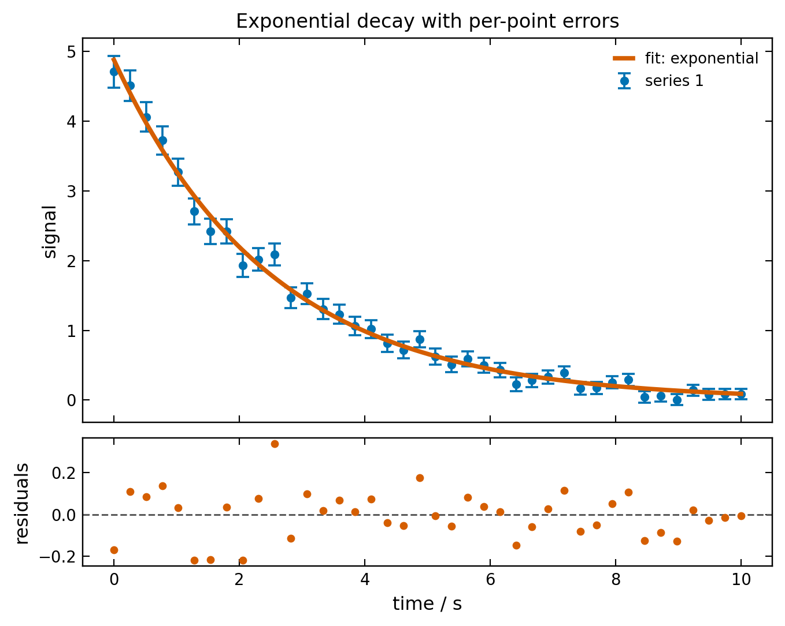

   Each data point has its own uncertainty, shown by the error bars that vary
   in size across the dataset. The fit weights points accordingly.

Exponential fit console output
~~~~~~~~~~~~~~~~~~~~~~~~~~~~~~

.. code-block:: console

   amplitude = 4.880850 ± 0.100131
   decay = 0.399328 ± 0.008559
   reduced chi^2 = 0.768797

.. _gallery-subset-fit:

Fitting a subset of your data
-----------------------------

Fit only a region of interest (the peak) while plotting the full dataset,
including the background. This is useful when your signal has a clear
feature on top of a slowly-varying baseline.

.. code-block:: python

   import numpy as np
   from labfit import fit_curve, plot_fit, Series

   rng = np.random.default_rng(20260618)
   x = np.linspace(0.0, 10.0, 300)
   y = (3.0 * np.exp(-0.5 * ((x - 5.0) / 0.8) ** 2)
        + 0.05 * np.sin(1.5 * x)
        + rng.normal(0, 0.03, size=x.size))

   full = Series(x=x, y=y, sigma=0.03, label="full data")

   # Fit only the peak region
   mask = (x > 3.5) & (x < 6.5)
   result = fit_curve("gaussian", x[mask], y[mask], 0.03)

   plot = plot_fit(result, data_series=full,
                   title="Gaussian fit to peak region only")
   plot.save("docs/_static/gallery/subset_fit.png")

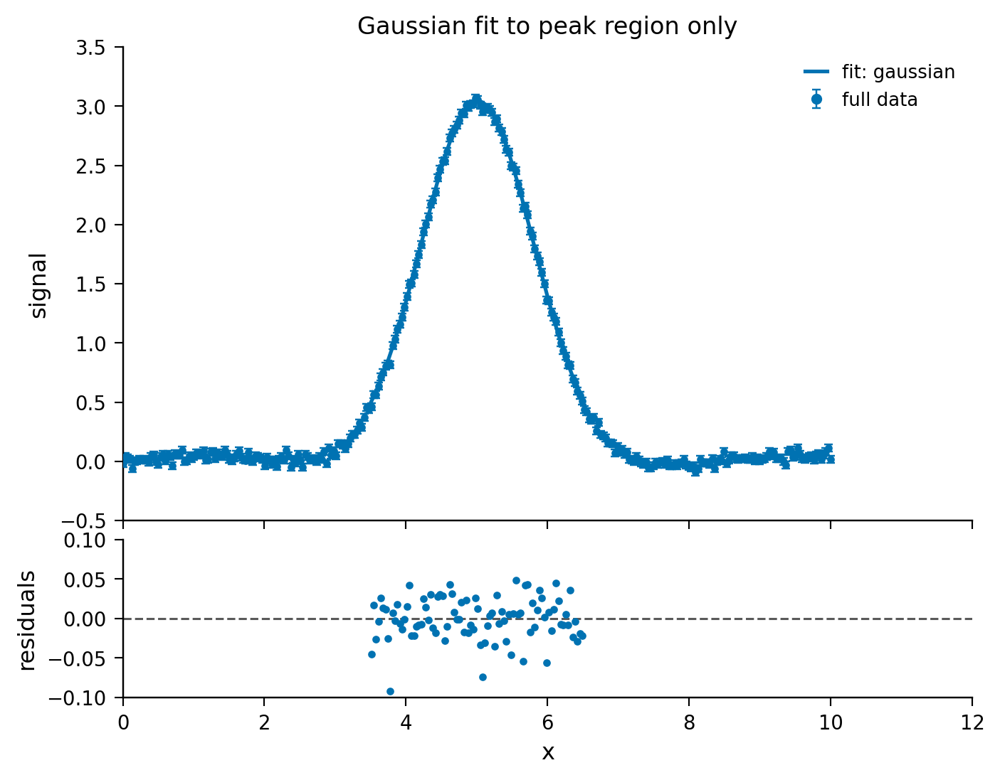

   The fit was performed only on points with ``3.5 < x < 6.5``,
   but the plot shows the full dataset with error bars.

Subset fit console output
~~~~~~~~~~~~~~~~~~~~~~~~~

.. code-block:: console

   amplitude = 3.044423 ± 0.005250
   mean = 5.010007 ± 0.001580
   sigma = 0.791448 ± 0.001760
   reduced chi^2 = 0.805082

.. _gallery-model-comparison:

Comparing two models on the same data
--------------------------------------

Sometimes you are not sure which model is the right one. Fit the data with
both and overlay the results on a single plot — the eye catches tail
mismatches, and the reduced χ² confirms what you see.

Here the data comes from a Gaussian peak. The Gaussian fit (orange) recovers
the parameters with χ² ≈ 1. The Lorentzian fit (green) is close near the
centre but its heavier tails diverge from the data in the wings, giving
χ² ≈ 17.

.. code-block:: python

   import numpy as np
   from labfit import fit, plot_fit

   rng = np.random.default_rng(20260620)
   x = np.linspace(-4.0, 8.0, 200)
   y_true = 5.0 * np.exp(-0.5 * ((x - 2.0) / 1.0) ** 2)
   sigma = np.full_like(x, 0.08)
   y = y_true + rng.normal(0.0, sigma)

   # Correct model
   result_gaussian = fit(x, y, model="gaussian", sigma=sigma, label="data")

   # Close but wrong — Lorentzian has heavier tails
   result_lorentzian = fit(x, y, model="lorentzian", sigma=sigma)

   # Share the series to draw the observations once and vary the fit line styles.
   result_lorentzian.series = result_gaussian.series

   plot = plot_fit(
       [result_gaussian, result_lorentzian],
       show_residuals=False,
       title="Gaussian vs Lorentzian model comparison",
       xlabel="position",
       ylabel="intensity",
   )
   plot.save("docs/_static/gallery/model_comparison.png")

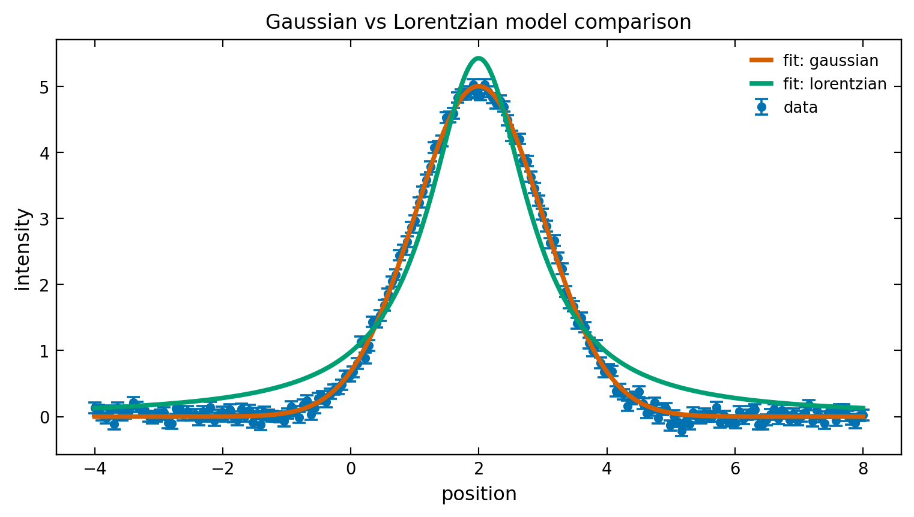

   Both fit lines are drawn on the same axis. The Gaussian (orange) matches
   the data; the Lorentzian (green) deviates in the tails. The reduced χ²
   quantifies the difference: 1.07 vs 17.2.

Gaussian (correct model) console output
~~~~~~~~~~~~~~~~~~~~~~~~~~~~~~~~~~~~~~~

.. code-block:: console

   FitResult: gaussian
     amplitude = 5.0018 +/- 0.018636
     mean = 1.9985 +/- 0.004314
     sigma = 1.0027 +/- 0.004314
     reduced chi2 = 1.066
     p = 0.249

Lorentzian (close but wrong) console output
~~~~~~~~~~~~~~~~~~~~~~~~~~~~~~~~~~~~~~~~~~~

.. code-block:: console

   FitResult: lorentzian
     amplitude = 5.4251 +/- 0.095026
     center = 1.9966 +/- 0.016386
     gamma = 0.93677 +/- 0.023328
     reduced chi2 = 17.16  -- model may be wrong or errors underestimated
     p ~ 0.0e+00

.. _gallery-confidence-bands:

Confidence and prediction bands
--------------------------------

When ``absolute_sigma=True``, LabFit can draw a **mean-response confidence band**
(uncertainty in the fitted line) and a **future-observation prediction band**
(uncertainty for a new single measurement).  Pass ``show_ci=True`` to
:func:`labfit.plot_fit`; add ``prediction=True`` and ``prediction_sigma`` for the
wider band.

.. code-block:: python

   import numpy as np
   from labfit import fit, plot_fit

   rng = np.random.default_rng(101)
   x = np.linspace(0, 50, 26)
   sigma = np.full(26, 0.045)
   y = 0.082 * x + 0.18 + rng.normal(0.0, sigma)

   result = fit(x, y, sigma=sigma, model="linear", absolute_sigma=True)

   # Mean-response confidence band (uncertainty in the fitted line)
   plot_ci = plot_fit(
       result,
       show_ci=True, ci_level=0.95,
       xlabel="Reference temperature (°C)", ylabel="Sensor voltage (V)",
       title="Linear calibration: 95 % confidence band",
   )
   plot_ci.save("docs/_static/gallery/confidence_band.png")

   # Future-observation prediction band (new single measurement)
   plot_pred = plot_fit(
       result,
       show_ci=True, prediction=True, ci_level=0.95, prediction_sigma=0.045,
       xlabel="Reference temperature (°C)", ylabel="Sensor voltage (V)",
       title="Linear calibration: 95 % prediction band",
   )
   plot_pred.save("docs/_static/gallery/prediction_band.png")

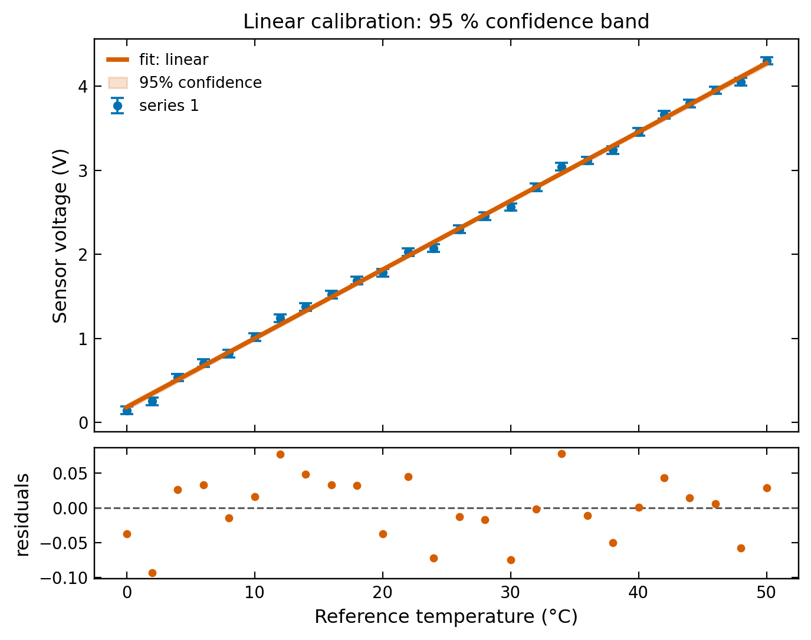

   The shaded region shows the 95 % confidence interval for the mean response.

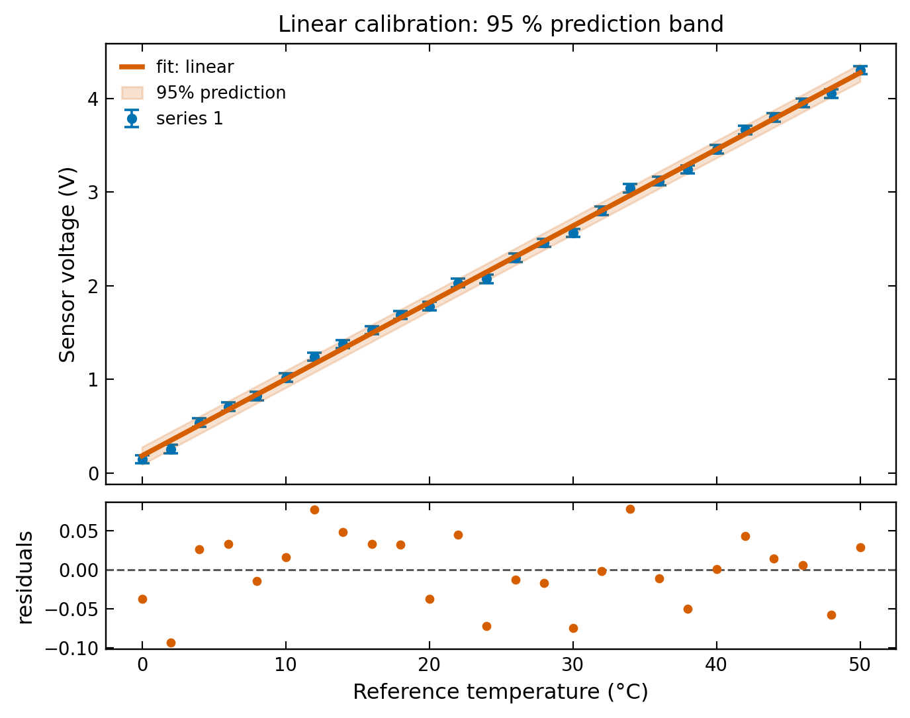

   The wider shaded region shows where a single new observation is expected to fall
   with 95 % probability, accounting for both fit uncertainty and measurement noise.

Confidence band console output
~~~~~~~~~~~~~~~~~~~~~~~~~~~~~~~

.. code-block:: console

   FitResult: linear
     slope = 0.081836 +/- 0.00058835
     intercept = 0.18191 +/- 0.017153
     degrees of freedom = 24
     residual variance = 0.002175 (y units squared)
     reduced chi2 = 1.074
     p = 0.365

.. _gallery-error-propagation:

Derived quantities via error propagation
-----------------------------------------

Use :func:`labfit.utils.propagate_errors` to compute uncertainties for quantities
that depend on fitted parameters.  The function accepts a scalar Jacobian for
single-parameter propagation, or a full covariance matrix for multi-parameter
propagation.

This example fits an exponential decay and derives the **half-life**
:math:`t_{1/2} = \ln 2 / \lambda`, propagating the uncertainty in the decay rate.

.. code-block:: python

   import numpy as np
   from labfit import fit, plot_fit
   from labfit.utils import propagate_errors

   rng = np.random.default_rng(202)
   x = np.linspace(0, 12, 49)
   sigma = np.full(49, 0.075)
   y = 4.8 * np.exp(-0.24 * x) + rng.normal(0.0, sigma)

   # Estimate initial decay rate from two well-separated points
   mid = len(y) // 2
   rate_guess = np.log(y[0] / y[mid]) / x[mid]

   result = fit(
       x, y, sigma=sigma,
       model="exponential",
       absolute_sigma=True,
       p0={"amplitude": float(y[0]), "decay": float(rate_guess)},
       bounds={"amplitude": (0, None), "decay": (0.001, 2)},
   )

   half_life, half_life_error = propagate_errors(
       lambda decay: np.log(2.0) / decay,
       jacobian=lambda decay: -np.log(2.0) / decay ** 2,
       decay=result.params["decay"],
       decay_error=result.uncertainties["decay"],
   )
   print(f"half-life = {half_life:.4f} ± {half_life_error:.4f} s")

   plot = plot_fit(
       result,
       show_ci=True, ci_level=0.95,
       xlabel="Time (s)", ylabel="Signal voltage (V)",
       title="Exponential signal decay",
   )
   plot.save("docs/_static/gallery/error_propagation.png")

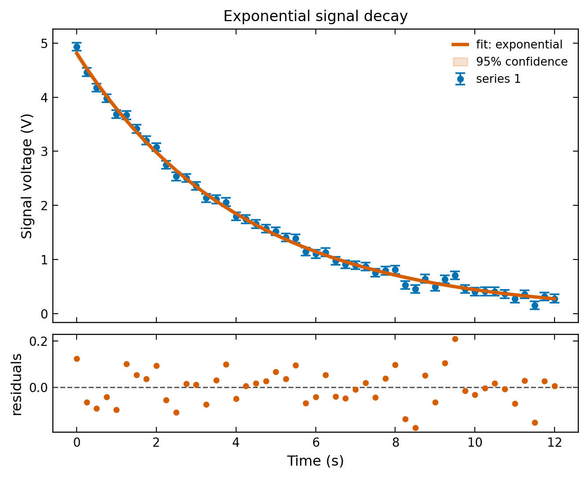

   Exponential decay fit with a 95 % confidence band.  The half-life and its
   uncertainty are derived from the fitted decay rate using error propagation.

Error propagation console output
~~~~~~~~~~~~~~~~~~~~~~~~~~~~~~~~~~

.. code-block:: console

   FitResult: exponential
     amplitude = 4.8119 +/- 0.035208
     decay = 0.23918 +/- 0.0026418
     degrees of freedom = 47
     residual variance = 0.006093 (y units squared)
     reduced chi2 = 1.083
     p = 0.322
   half-life = 2.8980 +/- 0.0320 s

.. _gallery-spectral-peak:

Spectral peak with a sloping background
-----------------------------------------

Real spectra often sit on a slowly-varying background.  Use the built-in
``gaussian_baseline`` model (Gaussian peak + linear baseline) and supply
initial guesses derived from the edge regions of the spectrum.

The example also fits a plain Gaussian (without baseline) to show that ignoring
the background inflates χ² and distorts the parameter estimates.

.. code-block:: python

   import numpy as np
   from labfit import fit, plot_fit

   rng = np.random.default_rng(303)
   x = np.linspace(-3.5, 3.5, 141)
   y_true = 2.8 * np.exp(-0.5 * ((x - 0.35) / 0.62) ** 2) + 0.12 * x + 0.7
   sigma = 0.045 + 0.018 * np.sqrt(y_true)
   y = y_true + rng.normal(0.0, sigma)

   # Estimate background slope from the edge points
   edge = np.abs(x) > 2.5
   slope, intercept = np.polyfit(x[edge], y[edge], 1)
   corrected = y - slope * x - intercept
   centre = float(x[np.argmax(corrected)])

   # Correct model: Gaussian + linear baseline
   result = fit(
       x, y, sigma=sigma,
       model="gaussian_baseline",
       absolute_sigma=True,
       p0={"amplitude": float(corrected.max()), "mean": centre,
           "sigma": 0.7, "m": float(slope), "b": float(intercept)},
       bounds={"amplitude": (0, None), "mean": (-1.5, 1.5), "sigma": (0.1, 2)},
   )
   plot = plot_fit(
       result,
       xlabel="Wavelength offset from 550 nm (nm)", ylabel="Signal (mV)",
       title="Gaussian + linear baseline",
   )
   plot.save("docs/_static/gallery/gaussian_baseline.png")

   # Incorrect model: plain Gaussian — chi^2 reveals the misspecification
   wrong = fit(
       x, y, sigma=sigma,
       model="gaussian",
       absolute_sigma=True,
       p0={"amplitude": float(y.max()), "mean": centre, "sigma": 0.7},
       bounds={"amplitude": (0, None), "mean": (-1.5, 1.5), "sigma": (0.1, 4)},
   )
   print(f"With baseline   chi^2_r = {result.reduced_chi2:.3f}")
   print(f"Without baseline chi^2_r = {wrong.reduced_chi2:.3f}")

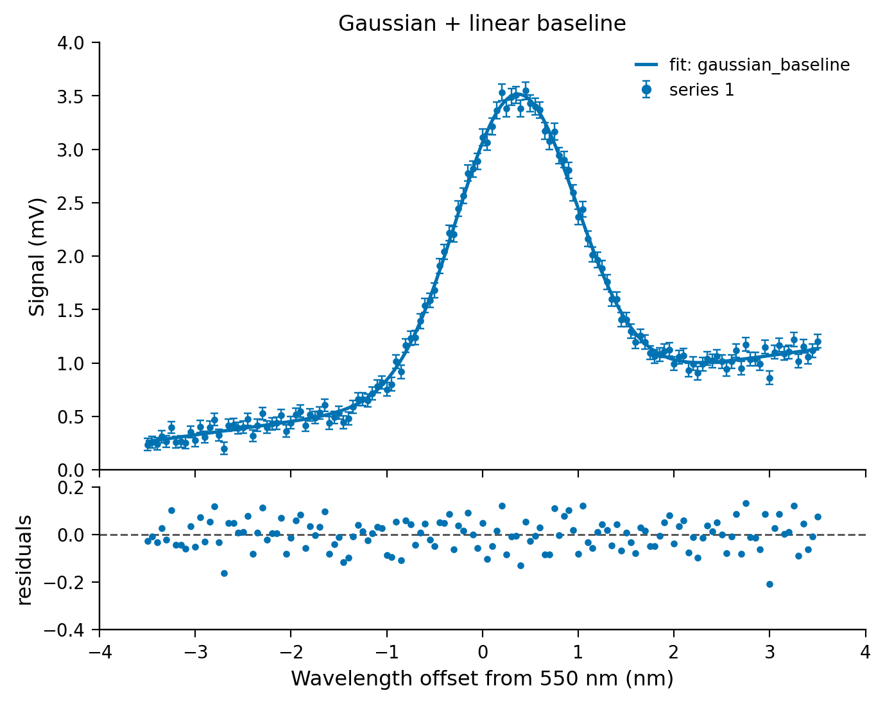

   The ``gaussian_baseline`` model captures the sloping background.  Fitting a
   plain Gaussian (no baseline) gives χ²_r ≫ 1, exposing the misspecification.

Gaussian baseline console output
~~~~~~~~~~~~~~~~~~~~~~~~~~~~~~~~~~

.. code-block:: console

   FitResult: gaussian_baseline
     amplitude = 2.773 +/- 0.020435
     mean = 0.35311 +/- 0.0049682
     sigma = 0.62542 +/- 0.0052895
     m = 0.12364 +/- 0.0026217
     b = 0.69802 +/- 0.0070744
     degrees of freedom = 136
     residual variance = 0.004226 (y units squared)
     reduced chi2 = 1.044
     p = 0.345
   With baseline    chi2_r = 1.044
   Without baseline chi2_r = 47.774

.. _gallery-custom-model:

Custom model with multiple starting points
------------------------------------------

When fitting overlapping peaks, the optimizer can get stuck in a local minimum
depending on the starting guess.  Run the fit from several starting points, keep
only the successful, identifiable solutions, and pick the one with the lowest
reduced χ².

.. code-block:: python

   import numpy as np
   from labfit import fit

   rng = np.random.default_rng(505)
   u = np.linspace(-2.0, 3.0, 201)
   y_true = (
       2.5 * np.exp(-0.5 * ((u + 0.1) / 0.43) ** 2)
       + 1.8 * np.exp(-0.5 * ((u - 0.8) / 0.52) ** 2)
       + 0.06 * u + 0.35
   )
   sigma = np.full_like(u, 0.055)
   y = y_true + rng.normal(0.0, sigma)

   def double_peak(u, A1, c1, w1, A2, c2, w2, m, b):
       return (A1 * np.exp(-0.5 * ((u - c1) / w1) ** 2)
               + A2 * np.exp(-0.5 * ((u - c2) / w2) ** 2)
               + m * u + b)

   # Estimate background from edge points and peak height
   edge = (u < -1.2) | (u > 2.2)
   slope, baseline = np.polyfit(u[edge], y[edge], 1)
   peak_height = float(np.max(y - slope * u - baseline))

   starts = [(-0.35, 0.65, 0.35), (0.0, 1.0, 0.55), (-0.2, 0.9, 0.75)]
   candidates = []
   for left, right, width in starts:
       candidate = fit(
           u, y, sigma=sigma, model=double_peak, absolute_sigma=True,
           p0={"A1": 0.7 * peak_height, "c1": left, "w1": width,
               "A2": 0.5 * peak_height, "c2": right, "w2": width,
               "m": float(slope), "b": float(baseline)},
           bounds={"A1": (0, 10), "A2": (0, 10), "c1": (-0.6, 0.25),
                   "c2": (0.4, 1.5), "w1": (0.15, 1.2), "w2": (0.15, 1.2)},
       )
       candidates.append(candidate)

   valid = [r for r in candidates if r.success and r.identifiable]
   result = min(valid, key=lambda r: r.reduced_chi2)
   print(f"c1 = {result.params['c1']:.4f} +/- {result.uncertainties['c1']:.4f} nm")
   print(f"c2 = {result.params['c2']:.4f} +/- {result.uncertainties['c2']:.4f} nm")
   print(f"reduced chi^2 = {result.reduced_chi2:.4f}")

Custom model console output
~~~~~~~~~~~~~~~~~~~~~~~~~~~~

.. code-block:: console

   c1 = -0.1092 +/- 0.0162 nm
   c2 =  0.7903 +/- 0.0340 nm
   reduced chi^2 = 1.0790

.. _gallery-gls:

Generalized least squares with correlated errors
-------------------------------------------------

Standard least squares assumes independent measurement errors.  When errors are
correlated (e.g. thermal drift, shared environmental noise), pass a full covariance
matrix via ``sigma_cov``.  LabFit performs **generalized least squares** (GLS),
whitening the residuals internally.

.. code-block:: python

   import numpy as np
   from labfit import fit, plot_fit

   rng = np.random.default_rng(606)
   x = np.linspace(0, 120, 81)
   y_true = 12 * (1 - np.exp(-x / 28)) + 21

   # AR(1)-like covariance: correlated_sigma^2 * rho^|i-j| + independent noise
   index = np.arange(x.size)
   rho, corr_sigma, indep_sigma = 0.78, 0.20, 0.06
   covariance = (corr_sigma ** 2 * rho ** np.abs(index[:, None] - index[None, :])
                 + indep_sigma ** 2 * np.eye(x.size))
   y = y_true + np.linalg.cholesky(covariance) @ rng.normal(size=x.size)

   # GLS fit using the full measurement covariance
   result = fit(
       x, y,
       sigma_cov=covariance,
       model="exponential_rise",
       p0={"amplitude": float(y[-1] - y[0]), "tau": 30.0, "offset": float(y[0])},
       bounds={"amplitude": (0, 30), "tau": (1, 200), "offset": (10, 30)},
       absolute_sigma=True,
   )
   plot = plot_fit(
       result,
       show_ci=True, ci_level=0.95,
       xlabel="Time (s)", ylabel="Temperature (deg C)",
       title="Thermal response: generalized least squares",
   )
   plot.save("docs/_static/gallery/generalized_least_squares.png")
   print(result)

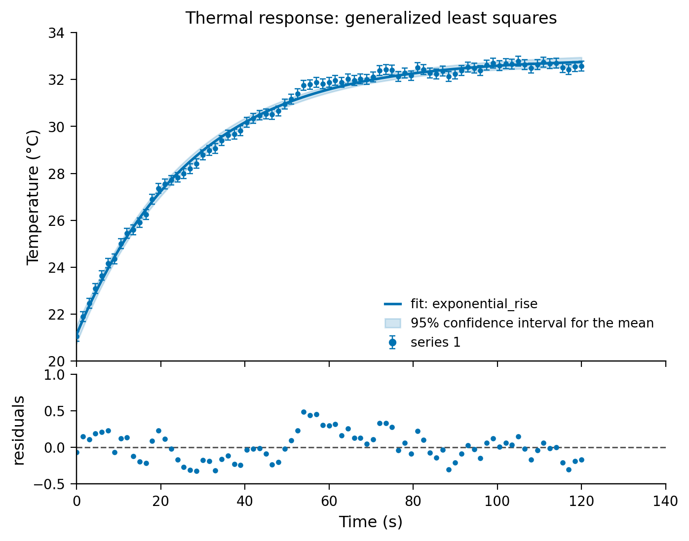

   The fit accounts for the AR(1)-like covariance structure of the measurement errors.
   The 95 % confidence band reflects the full correlated uncertainty.

GLS console output
~~~~~~~~~~~~~~~~~~~

.. code-block:: console

   FitResult: exponential_rise
     amplitude = 11.766 +/- 0.20335
     tau = 27.31 +/- 1.139
     offset = 21.123 +/- 0.19191
     degrees of freedom = 78
     residual variance = 0.03933 (y units squared)
     reduced chi2 = 0.8221
     p = 0.871
