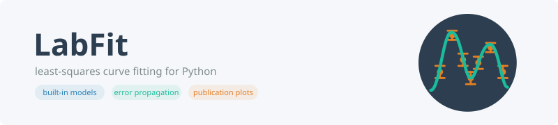

.. LabFit documentation master file.

   Homepage: https://matthewd0yle.com/labfit/
   Contact: matt@matthewd0yle.com
   License: MIT

Welcome to LabFit
=================

.. raw:: html

   

     
pip install labfit

     Python ≥ 3.10
     MIT Licensed
     NumPy &amp; SciPy
   

`LabFit` is a lightweight, student-friendly Python library for least-squares curve fitting,
error propagation, and scientific plotting.

It ships with built-in textbook models, automatic initial guesses,
and a publication-quality plotting layer with residual subplots and multi-series comparisons.

Core Features
-------------

- **Reproducible workflows** from CSV or NumPy arrays to fitted parameters in seconds.
- **Reduced χ² (chi-square) diagnostics** computed automatically to assess goodness-of-fit.
- **Publication-ready plotting** with residuals, confidence bands, and multi-series axes.
- **Rigorous uncertainty handling** for correlated, asymmetric, and derived quantities.
- **Complete, typed reference docs** for every fitter, model function, and utility.

.. note::

   **Hands-on Tutorials**: Six worked experimental lab walkthroughs (sensor calibration, decay kinetics, Gaussian peaks, damped oscillations, and GLS) with runnable scripts and CSV data are available in the repository under ``examples/tutorial/``.

.. toctree::
   :hidden:

   quickstart
   concepts
   least-squares
   fitting-functions
   api
   utilities
   gallery
   faq

Explore the Docs
----------------

.. grid:: 1 2 2 3
   :gutter: 3

   .. grid-item-card:: 5-Minute Quickstart
      :link: quickstart
      :link-type: doc

      From CSV to fitted curve, reduced χ², and residuals plot in 5 minutes.

   .. grid-item-card:: How Least-Squares Works
      :link: least-squares
      :link-type: doc

      Visual intuition: residuals, χ² landscapes, curvature, and optimisers.

   .. grid-item-card:: Core Concepts
      :link: concepts
      :link-type: doc

      Diagnostics, reduced χ², degrees of freedom, and error propagation.

   .. grid-item-card:: Built-in Models & Fitters
      :link: fitting-functions
      :link-type: doc

      Textbook physics models: linear, polynomial, Gaussian, exponential, and power laws.

   .. grid-item-card:: Visual Gallery
      :link: gallery
      :link-type: doc

      12 runnable examples with publication-ready plots and console outputs.

   .. grid-item-card:: Utilities & I/O
      :link: utilities
      :link-type: doc

      CSV/TXT loaders, error transforms, and variance-covariance helpers.

   .. grid-item-card:: API Reference
      :link: api
      :link-type: doc

      Complete docstrings and signatures for all functions and classes.

   .. grid-item-card:: Frequently Asked Questions
      :link: faq
      :link-type: doc

      Initial guesses, weighting choices, correlated errors, and common pitfalls.
