# Getting started

## What you will learn

A useful laboratory fit connects a physical question to a mathematical model,
measured observations, and an honest account of uncertainty. Drawing a smooth
curve is one part of that process. Deciding whether the model explains the
observations, and whether the reported parameter errors are credible, takes
more care.

This tutorial introduces that workflow using **LabFit**, a Python library built
on NumPy, SciPy and Matplotlib. You will analyse six synthetic experiments,
moving from a straight-line calibration to overlapping peaks and correlated
measurement errors. Every example includes an executable script, the observations,
figures, fitted results and an interpretation.

The intended reader knows basic Python variables, functions and arrays, and has
met measurement uncertainty in a laboratory course. You do not need prior
experience with nonlinear optimisation. The mathematics is introduced alongside
the code that uses it.

| Stage | Experiment | New capability |
| --- | --- | --- |
| Simple | Sensor calibration | CSV loading, linear fitting, prediction |
| Simple | Signal decay | Nonlinear fitting, derived half-life |
| Intermediate | Single spectral peak | Background terms, bounds, covariance propagation |
| Intermediate | Repeated oscillations | Independent fits to multiple series |
| Complex | Overlapping spectral peaks | Custom model, multiple starts, correlations |
| Complex | Thermal response | Generalized least squares, whitened residuals |

Read the examples in sequence on a first pass. Later, use the individual scripts
as starting points for your own analysis. These experiments are illustrative;
**no real instrument or material was measured**. The generating truth is available
for validation, but the analysis scripts do not read it to choose fitted values.

## Install the current checkout

The tutorial follows the interfaces in this repository. LabFit requires Python
3.10 or later. Install this checkout into an isolated environment so that the
examples and the library version agree.

~~~sh
git clone https://github.com/matthewjdoyle/labfit.git
cd labfit
python -m venv .venv
~~~

Activate the environment using the command for your platform:

~~~sh
# Windows PowerShell
.venv\Scripts\Activate.ps1

# macOS or Linux
source .venv/bin/activate
~~~

Then install and run the demonstrations:

~~~sh
python -m pip install -e .
python examples/tutorial/run_examples.py
~~~

The run creates or refreshes the figures and `results.json`. It uses a
non-interactive Matplotlib backend, so you do not need to close plot windows.
A warning about the Gaussian model in Example 3 is expected: that example
deliberately fits an incomplete model to reveal its limitations.

The supplied document was built using **labfit 0.2.0, numpy 2.2.6, scipy 1.15.2, matplotlib 3.10.1**. Small differences in
the final digits can occur with other supported numerical-library versions.
Interpret uncertainties and physical scales rather than demanding identical
floating-point results across every platform.

## Orient yourself in the tutorial package

Keep the files in `examples/tutorial/` together. The directory contains:

| Item | Purpose |
| --- | --- |
| `data/*.csv` | Observations, with explicit measurement errors |
| `data/manifest.json` | Seeds, units, equations, noise assumptions and generating truth |
| `example_01_*.py` through `example_06_*.py` | Complete executable analyses |
| `common.py` | Figure-saving and reporting helpers |
| `figures/` | PNG images for reading and vector PDF images for printing |
| `results.json` | Full computed results, including fitted covariance |
| `tutorial.md`, `tutorial.tex`, `tutorial.pdf` | The three presentation formats |

The code excerpts below are drawn directly from the executable scripts.
They show the analysis within each script's `run` function. The complete files
contain the imports, reporting and plotting helpers needed to execute them.

For an interactive session, start with these common imports and paths:

~~~python
from pathlib import Path
import numpy as np
from labfit import fit, fit_multi, plot_fit, plot_multi_fit
from labfit.io import load_csv
from labfit.utils import propagate_errors

data = Path("examples/tutorial/data")  # from the repository root
~~~

Use `plot.save("my_fit.png")` to save a LabFit plot. The tutorial's
`save_figure` helper saves both PNG and PDF and closes the figure; the helper
is a convenience for this package, rather than part of LabFit.

## Start with the observations

The basic CSV layout is deliberately simple:

~~~text
x,y,sigma
0.0,0.19,0.045
2.0,0.35,0.045
~~~

These two rows illustrate the format; the actual measured values appear in the
worked examples. Here `sigma` means the standard deviation of measurement
noise in **y**, in the same units as y. It is not a variance, percentage, or
confidence-interval width. The standard CSV reader recognises this column.

~~~python
series = load_csv(data / "calibration.csv")
print(series.x.shape, series.y.shape)
print(series.sigma)
~~~

LabFit can also fit arrays directly, accept a CSV path, or use a `DataSeries`
object that carries data, a label and an uncertainty specification. Loading first
is useful when you want to inspect observations before committing to a model.

All x values in these experiments are treated as exact. If your reference
temperatures, wavelengths or times have appreciable uncertainty, that assumption
needs examination. The examples do not demonstrate errors-in-variables fitting.

# The fitting workflow

## State a model and a noise assumption

Write a model $M(x;\boldsymbol{\theta})$ that represents the expected response.
The vector $\boldsymbol{\theta}$ contains the parameters to estimate. A linear
calibration, for example, has slope and intercept.

The observed response differs from the model by a residual:

$$
r_i = y_i - M(x_i;\hat{\boldsymbol{\theta}}).
$$

The hat denotes fitted parameters. This definition matches
`result.residuals`: observations minus fitted predictions.

For independent Gaussian measurement errors with known standard deviations
$s_i$, weighted least squares minimises

$$
\chi^2(\boldsymbol{\theta})
= \sum_{i=1}^{N}\left[\frac{y_i-M(x_i;\boldsymbol{\theta})}{s_i}\right]^2.
$$

The **standardized residual** $z_i=r_i/s_i$ is dimensionless. A raw residual of
0.1 V might be small for one instrument and enormous for another; standardized
residuals let you judge it against its stated error. LabFit's default residual
panel displays **raw residuals**, so this tutorial labels those panels with units.

The supplied data use known Gaussian noise scales. We therefore consistently
pass `absolute_sigma=True`. That choice affects the reported parameter
covariance; it does not change the optimum for a fixed model and error
specification.

## Read the result before trusting the curve

~~~python
result = fit(series, model="linear", absolute_sigma=True)
print(result)
print(result.params)
print(result.uncertainties)

if not result.success:
    raise RuntimeError(result.message)
if not result.identifiable:
    raise RuntimeError("The observations do not distinguish every parameter.")
~~~

`success` reports whether the optimiser converged. `identifiable` reports a
local Jacobian diagnostic: whether changes in the parameters produce sufficiently
distinct changes in the predicted observations. A model can converge even when
several parameters can trade off without changing its predictions.

For $N$ observations and $k$ free parameters, the degrees of freedom are

$$
\nu=N-k,\qquad \chi^2_\nu=\frac{\chi^2}{\nu}.
$$

Under an appropriate model and calibrated independent Gaussian errors, reduced
chi-square is expected to fluctuate around one. A rough fluctuation scale is
$\sqrt{2/\nu}$ for the linear Gaussian setting. Thus 1.1 may be unremarkable
for a small experiment and more noteworthy for thousands of observations.

A large value can indicate omitted structure, underestimated errors or outliers.
A small value can indicate overestimated errors, unusual sampling fluctuations
or an overly flexible model. The statistic alone cannot identify the cause.
Inspect the residuals and revisit how the measurements were made.

The chi-square p-value is the upper-tail probability of obtaining a chi-square
at least this large under the assumed model and error specification. It is
**not the probability that the model is true**. Nonlinear fits use a local
approximation, and fitted bounds or model-selection steps can complicate the
interpretation further.

## Parameter errors and two different covariances

LabFit stores fitted parameter covariance in `result.covariance`, with its
rows and columns ordered by `result.param_names`. Standard errors are the
square roots of the diagonal entries. These are local estimates around the
optimum; strong nonlinearity, active bounds or inadequate data can make a
symmetric error summary misleading.

Use different symbols for two different objects:

| Symbol | Meaning | Dimensions |
| --- | --- | --- |
| $C_y$ | Covariance between measurement errors | $N\times N$ |
| $C_\theta$ | Covariance between fitted parameter estimates | $k\times k$ |

The thermal experiment supplies $C_y$ through `sigma_cov`. The fitting result
provides $C_\theta$. You cannot substitute one for the other.

For a weighted residual Jacobian $J$, a locally full-rank model has approximately

$$
C_\theta^{\mathrm{absolute}}=(J^T J)^{-1},\qquad
C_\theta^{\mathrm{relative}}=C_\theta^{\mathrm{absolute}}\,\chi^2_\nu.
$$

The default `absolute_sigma=False` uses the supplied errors as relative
weights and estimates a common scale from residual scatter. Use that policy
when only the relative weighting is justified. In these synthetic experiments,
the supplied sigmas are calibrated absolute uncertainties, so rescaling them
from residuals would discard known information.

## Missing uncertainties and unweighted analysis

If a CSV omits error columns, LabFit can infer heuristic uncertainties and
emits a warning of type `UncertaintyInferenceWarning`. The formula and provenance are stored
on the loaded series. A heuristic is an exploratory assumption; it does not
turn missing measurement knowledge into a calibrated error model.

For an explicitly unweighted analysis:

~~~python
unweighted = load_csv(data / "calibration.csv", error_mode="unweighted")
relative_result = fit(unweighted, model="linear")
print(relative_result.residual_variance)
~~~

This example intentionally ignores the supplied error column to illustrate the
interface. An unweighted result does not have meaningful weighted chi-square
or chi-square p-value; these fields are NaN. Use `residual_variance`, the raw
residual sum of squares divided by positive degrees of freedom, to describe
scatter in squared y units.

Supply exactly one fitting error specification: `sigma`, inverse-variance
`weights`, an asymmetric pair, or `sigma_cov`. These demonstrations use
symmetric errors and covariance. For asymmetric inputs, LabFit retains both
sides for plotting and fits using an effective root-mean-square sigma; this is
an approximation rather than a full asymmetric likelihood.

# Simple example 1: linear sensor calibration

## Question and model

A temperature sensor returns a voltage. We compare it with a reference
temperature over a controlled range and ask: **what voltage response should we
expect at a given temperature, and how uncertain is that mean response?**

The model is

$$
V(T)=mT+b.
$$

| Parameter | LabFit name | Meaning | Unit |
| --- | --- | --- | --- |
| $m$ | `slope` | Sensitivity | V/degree C |
| $b$ | `intercept` | Voltage at 0 degree C | V |

The synthetic experiment contains 26 evenly spaced temperatures from 0 to 50
degrees C. The generator uses $m=0.082$ V/degree C and $b=0.18$ V, then adds
independent Gaussian voltage noise with standard deviation 0.045 V. The seed
is 101. The reference temperatures are treated as exact.

The first observations in [the calibration CSV](data/calibration.csv) are:

| x | y | sigma |
| --- | --- | --- |
| 0 | 0.144443 | 0.045 |
| 2 | 0.252442 | 0.045 |
| 4 | 0.535149 | 0.045 |
| 6 | 0.705493 | 0.045 |
| 8 | 0.822064 | 0.045 |

## Load, fit and predict

Run the complete example:

~~~sh
python examples/tutorial/example_01_calibration.py
~~~

The script's analysis is:

~~~python
series = load_csv(data / "calibration.csv", label="Sensor calibration")
result = fit(series, model="linear", absolute_sigma=True)
temperature = 25.0
prediction = float(result.predict([temperature])[0])
gradient = np.array([temperature, 1.0])  # slope, intercept
prediction_error = float(np.sqrt(gradient @ result.covariance @ gradient))

confidence = plot_fit(
    result,
    show_ci=True,
    ci_level=0.95,
    xlabel="Reference temperature (deg C)",
    ylabel="Sensor voltage (V)",
    title="Linear calibration: mean-response confidence band",
)
raw_labels(confidence, "V")
save_figure(confidence, "01_calibration", figures)
future = plot_fit(
    result,
    show_ci=True,
    prediction=True,
    ci_level=0.95,
    prediction_sigma=0.045,
    xlabel="Reference temperature (deg C)",
    ylabel="Sensor voltage (V)",
    title="Linear calibration: future-observation prediction band",
)
raw_labels(future, "V")
save_figure(future, "01_prediction", figures)
~~~

The call to `fit` returns the slope and intercept. `predict` evaluates the
attached model using the fitted parameters. It can take an array of temperatures,
so the same method supports a single prediction or a dense plotting grid.

For a prediction at $T_*$, the gradient with respect to $(m,b)$ is
$\boldsymbol{g}=(T_*,1)^T$. Its mean-response uncertainty is

$$
s_{\mathrm{mean}}(T_*) =
\sqrt{\boldsymbol{g}^T C_\theta \boldsymbol{g}}.
$$

The off-diagonal covariance between slope and intercept is part of this
calculation. Simply adding the separate parameter-error contributions in
quadrature can give a different answer.

## Results and residuals

| Parameter | Estimate | Standard error | Unit |
| --- | --- | --- | --- |
| `slope` | 0.0818358 | 0.000588 | V/degree C |
| `intercept` | 0.18191 | 0.0172 | V |

Degrees of freedom: **24**; reduced chi-square: **1.074**; chi-square p-value: **0.3645**. Converged: **True**; identifiable: **True**.

| Derived quantity | Estimate | Standard error | Unit |
| --- | --- | --- | --- |
| Mean voltage at 25 deg C | 2.2278 | 0.00883 | V |

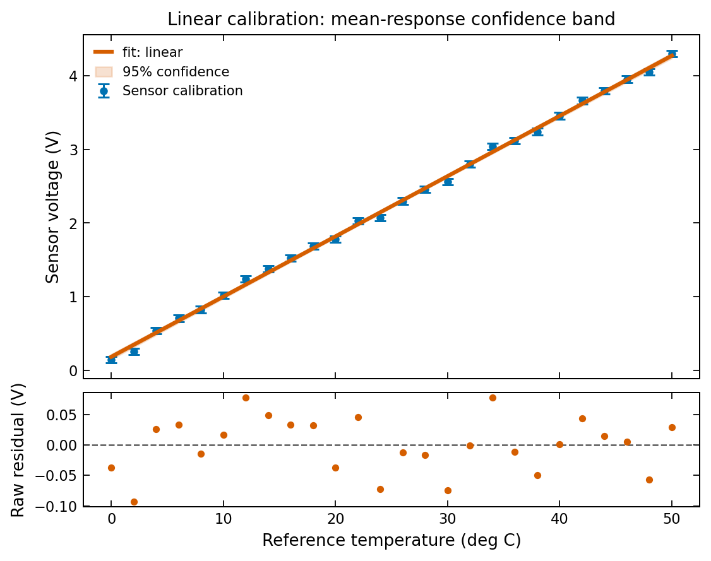

The estimated sensitivity is close to the generating value. The residuals
fluctuate around zero without a strong systematic trend, and their scale is
consistent with the supplied errors. Reduced chi-square and its p-value
support that reading of the plot; neither replaces inspection of the data.

The prediction at 25 degrees C is interpolation within the experiment. It is
usually safer than extrapolating beyond the measured range, where unmodelled
curvature or sensor saturation may become relevant.

## Mean response versus a future reading

There are two distinct questions: how uncertain is the estimated mean voltage,
and how variable will a single new measurement be? A new independent reading
contains both mean-response uncertainty and measurement noise.

$$
s_{\mathrm{future}}^2(T_*) =
s_{\mathrm{mean}}^2(T_*) + s_{\mathrm{new}}^2.
$$

The second plot passes the new reading's noise explicitly with
`prediction_sigma=0.045`. That number is an absolute standard deviation in
volts. It is never rescaled by reduced chi-square when passed explicitly.

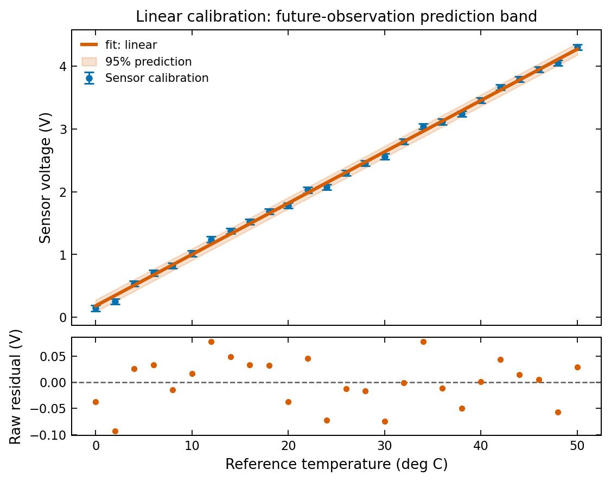

Both bands use **pointwise normal approximations**. A 95 percent pointwise band
does not promise that an entire future curve will stay inside it with
95 percent probability. The prediction calculation also assumes that the new
error is independent of the measurements used to estimate the parameters.

**Laboratory lesson:** report whether a band describes a fitted mean or a
future observation. A precise mean estimate does not eliminate instrument
noise in the next reading.

# Simple example 2: exponential signal decay

## Question and model

After a source is switched off, a signal decreases with time. We ask:
**what decay rate describes the signal, and what is the corresponding half-life?**

LabFit's `exponential` model uses a decay rate, rather than a time constant:

$$
S(t)=A\exp(-\lambda t).
$$

| Parameter | LabFit name | Meaning | Unit |
| --- | --- | --- | --- |
| $A$ | `amplitude` | Signal at zero time | V |
| $\lambda$ | `decay` | Decay rate | 1/s |

The 49 synthetic observations span 0 to 12 seconds. The generating values are
$A=4.8$ V and $\lambda=0.24$ per second. Independent Gaussian noise has standard
deviation 0.075 V, and the seed is 202. There is no additive background in this
experiment; this assumption is part of the model.

The first rows of [the decay CSV](data/decay.csv) are:

| x | y | sigma |
| --- | --- | --- |
| 0 | 4.93588 | 0.075 |
| 0.25 | 4.46579 | 0.075 |
| 0.5 | 4.1758 | 0.075 |
| 0.75 | 3.97915 | 0.075 |
| 1 | 3.68937 | 0.075 |

## Choose an initial estimate

A nonlinear model benefits from a physically plausible initial estimate.
Here the first reading estimates the amplitude. Two well-separated readings
that remain positive give an approximate rate:

$$
\lambda_0 \approx
\frac{\log[S(0)/S(t_1)]}{t_1}.
$$

This estimate only starts the optimiser. The final fit minimises the residuals
in the original voltage units, using all observations and their sigmas.

Taking logarithms of the entire noisy dataset and fitting a straight line
would change the error model. Constant voltage noise becomes nonconstant,
asymmetric noise after the logarithm, and negative readings cannot be logged.
The initial estimate does not make that transformation the fitting objective.

## Execute the analysis

~~~sh
python examples/tutorial/example_02_decay.py
~~~

~~~python
series = load_csv(data / "decay.csv", label="Decaying signal")
# Estimate a rate from two well-separated, still-positive readings.
midpoint = len(series.y) // 2
rate_guess = np.log(series.y[0] / series.y[midpoint]) / series.x[midpoint]
result = fit(
    series,
    model="exponential",
    absolute_sigma=True,
    p0={"amplitude": float(series.y[0]), "decay": float(rate_guess)},
    bounds={"amplitude": (0, None), "decay": (0.001, 2)},
)
half_life, half_life_error = propagate_errors(
    lambda decay: np.log(2.0) / decay,
    jacobian=lambda decay: -np.log(2.0) / decay**2,
    decay=result.params["decay"],
    decay_error=result.uncertainties["decay"],
)
plot = plot_fit(
    result,
    show_ci=True,
    ci_level=0.95,
    xlabel="Time (s)",
    ylabel="Signal voltage (V)",
    title="Exponential signal decay",
)
raw_labels(plot, "V")
save_figure(plot, "02_decay", figures)
~~~

Bounds enforce positive amplitude and rate. The supplied starting values lie
inside the bounds. On a different dataset, verify positive starting estimates
and appropriate physical ranges before using this recipe.

## Derive the half-life

The half-life $t_{1/2}$ is the time needed to halve the noiseless signal:

$$
t_{1/2}=\frac{\log 2}{\lambda},\qquad
s_{t_{1/2}} =
\left|\frac{-\log 2}{\lambda^2}\right|s_\lambda.
$$

`propagate_errors` evaluates the derived function and uses its gradient to
propagate uncertainty. This particular quantity depends only on the rate, so
one parameter's standard error is sufficient. A quantity depending on both
amplitude and rate should retain their covariance.

| Parameter | Estimate | Standard error | Unit |
| --- | --- | --- | --- |
| `amplitude` | 4.81192 | 0.0352 | V |
| `decay` | 0.239178 | 0.00264 | 1/s |

Degrees of freedom: **47**; reduced chi-square: **1.083**; chi-square p-value: **0.3225**. Converged: **True**; identifiable: **True**.

| Derived quantity | Estimate | Standard error | Unit |
| --- | --- | --- | --- |
| Half-life | 2.89804 | 0.032 | s |

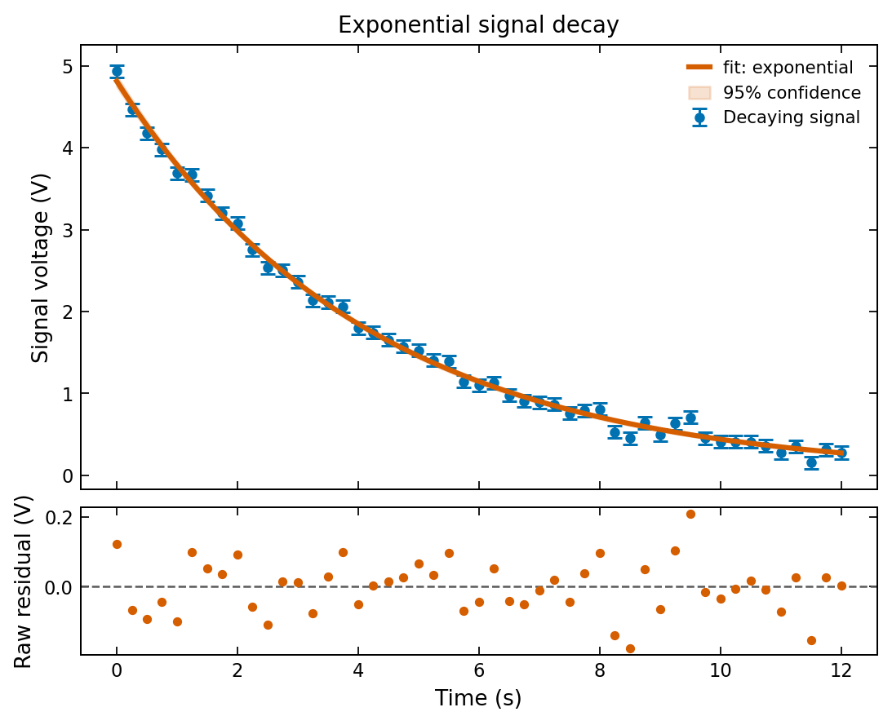

The half-life is close to the generating value $\log 2/0.24$, about 2.89 seconds.
The confidence band describes the fitted mean decay, rather than the likely
spread of a new voltage reading.

## Assess the physical assumptions

A systematic tail in the residuals could indicate an unmodelled background,
multiple decay components, or a time-dependent noise scale. A small standard
error on $\lambda$ would not repair those shortcomings.

The first-order error formula is appropriate when the local parameter
uncertainty is small enough for linearisation. If the rate is close to zero,
or a bound is active, half-life uncertainty can become strongly asymmetric.
Then a symmetric value-plus-error summary needs additional analysis.

**Laboratory lesson:** make the parameterisation explicit. A decay rate has
units of inverse time; a time constant and half-life have units of time.
Confusing them can produce a plausible-looking but physically wrong report.

# Intermediate example 3: a peak on a sloping background

## Question and model

A spectral peak sits above a slowly changing baseline. We ask:
**what are its centre, width and integrated signal once the background is
accounted for?**

Work in a wavelength offset $u=\lambda_{\mathrm{wavelength}}-550$ nm:

$$
I(u)=A\exp\left[-\frac{1}{2}
\left(\frac{u-\mu}{w}\right)^2\right]+mu+b.
$$

The slope symbol $m$ is unrelated to the calibration experiment's slope.
LabFit calls the Gaussian width parameter `sigma`; the symbol $w$ here keeps
it distinct from measurement sigmas $s_i$.

| LabFit name | Meaning | Unit |
| --- | --- | --- |
| `amplitude` | Peak height above baseline | mV |
| `mean` | Peak centre relative to 550 nm | nm |
| `sigma` | Gaussian width | nm |
| `m` | Background slope | mV/nm |
| `b` | Background at zero offset | mV |

There are 141 observations over offsets from -3.5 to 3.5 nm. The generator
uses amplitude 2.8 mV, centre 0.35 nm, width 0.62 nm, slope 0.12 mV/nm and
baseline 0.7 mV. Noise is independent Gaussian with known, varying standard
deviation

$$
s_i = 0.045 + 0.018\sqrt{I_{\mathrm{true}}(u_i)}
$$

when numerical signal values are expressed in mV. The coefficients define a
synthetic noise prescription, rather than a detector law. Seed 303 fixes the
random draws. Each supplied sigma is a calibrated noise scale, not an estimate
made from its individual noisy observation.

The first rows of [the single-peak CSV](data/single_peak.csv) are:

| x | y | sigma |
| --- | --- | --- |
| -3.5 | 0.23812 | 0.0545247 |
| -3.45 | 0.261617 | 0.0546262 |
| -3.4 | 0.244144 | 0.0547267 |
| -3.35 | 0.310927 | 0.0548261 |
| -3.3 | 0.266807 | 0.0549245 |

## Estimate a background before fitting

The far wings contain little peak signal. A straight-line estimate using these
points gives a useful background start. Subtracting that provisional background
makes it easier to estimate the peak height and centre.

This subtraction is used to obtain initial values. The final fit jointly
estimates all five parameters using the original observations. Treating a noisy
background estimate as exact and fitting only a subtracted peak would lose
uncertainty information.

~~~sh
python examples/tutorial/example_03_single_peak.py
~~~

~~~python
series = load_csv(data / "single_peak.csv", label="Peak plus background")
edge = np.abs(series.x) > 2.5
slope, intercept = np.polyfit(series.x[edge], series.y[edge], 1)
corrected = series.y - slope * series.x - intercept
centre = float(series.x[np.argmax(corrected)])
result = fit(
    series,
    model="gaussian_baseline",
    absolute_sigma=True,
    p0={
        "amplitude": float(corrected.max()),
        "mean": centre,
        "sigma": 0.7,
        "m": float(slope),
        "b": float(intercept),
    },
    bounds={"amplitude": (0, None), "mean": (-1.5, 1.5), "sigma": (0.1, 2)},
)
wrong = fit(
    series,
    model="gaussian",
    absolute_sigma=True,
    p0={"amplitude": float(series.y.max()), "mean": centre, "sigma": 0.7},
    bounds={"amplitude": (0, None), "mean": (-1.5, 1.5), "sigma": (0.1, 4)},
)
~~~

A positive width bound prevents a zero-width singularity. The centre bounds
identify the region of interest. Bounds encode assumptions and should be
justifiable from the experiment; they are not a substitute for informative data.

## Inspect the complete and incomplete models

| Parameter | Estimate | Standard error | Unit |
| --- | --- | --- | --- |
| `amplitude` | 2.77298 | 0.0204 | mV |
| `mean` | 0.353109 | 0.00497 | nm |
| `sigma` | 0.625423 | 0.00529 | nm |
| `m` | 0.123636 | 0.00262 | mV/nm |
| `b` | 0.698024 | 0.00707 | mV |

Degrees of freedom: **136**; reduced chi-square: **1.044**; chi-square p-value: **0.3448**. Converged: **True**; identifiable: **True**.

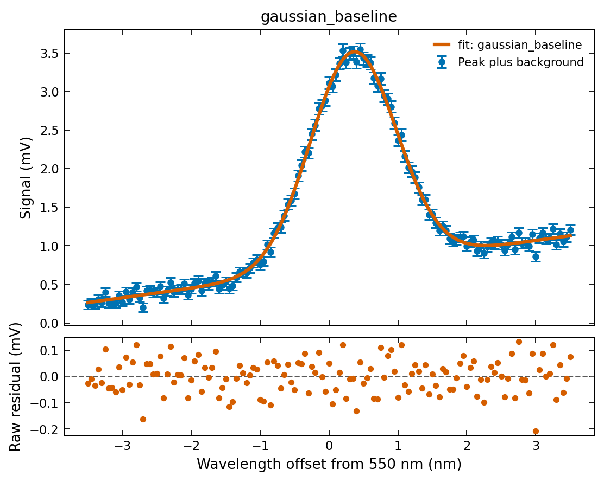

For comparison, the script fits `gaussian` without any background parameters.
That optimiser can converge, but it must absorb the baseline into its peak.

| Parameter | Estimate | Standard error | Unit |
| --- | --- | --- | --- |
| `amplitude` | 2.75936 | 0.0137 | mV |
| `mean` | 0.533883 | 0.00619 | nm |
| `sigma` | 1.2252 | 0.00618 | nm |

Degrees of freedom: **138**; reduced chi-square: **47.77**; chi-square p-value: **0**. Converged: **True**; identifiable: **True**.

The reported p-value of zero reflects floating-point underflow; interpret it as extremely small.

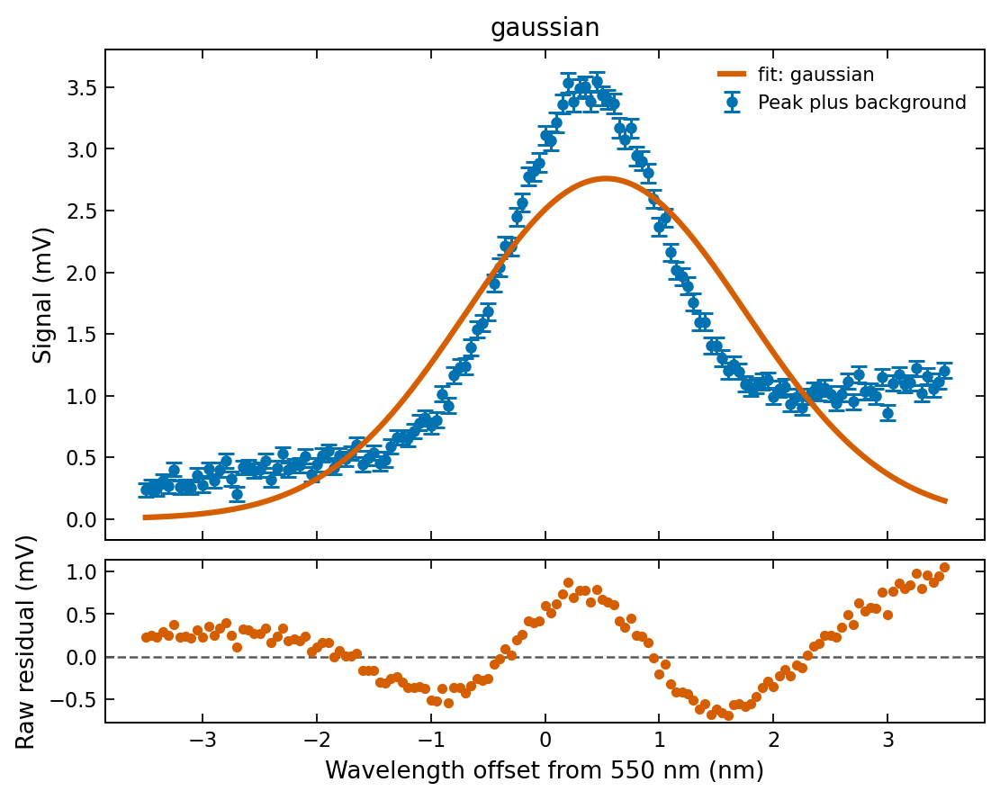

Reduced chi-square changes from
**47.7745** for the background-free
model to **1.04417** for the complete
model. The visual evidence also matters: the incomplete model leaves a
coherent residual pattern across wavelength.

Adding parameters generally improves a least-squares objective. That fact alone
does not establish that the larger model is physically correct. Here the
background is motivated by the experiment, residual structure disappears, and
the calibrated-error diagnostic becomes plausible.

Because errors vary between observations, standardized residuals are more
informative about the noise assumption:

~~~python
standardized = result.residuals / result.sigma
~~~

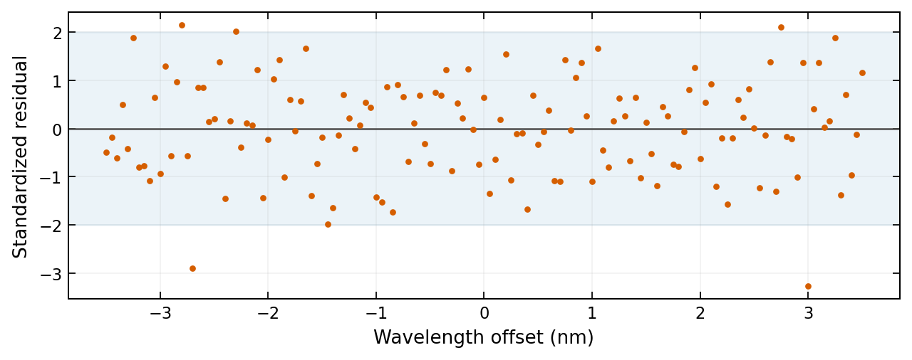

Do not expect every standardized residual to lie within two. Fitted residuals
also have leverage effects and are not exactly independent standard normal
draws, even when the underlying measurement errors are independent.

## Width and integrated peak area

Two quantities are useful for a spectral report. The full width at half maximum
and the baseline-subtracted area of an ideal Gaussian are

$$
\mathrm{FWHM}=2\sqrt{2\log 2}\,w,\qquad
Q=\sqrt{2\pi}\,Aw.
$$

$Q$ integrates the fitted Gaussian over the entire real line. It excludes
the baseline, and it is not the area of the full signal within the measured
window. Its units are mV nm.

Amplitude and width can trade off, so their covariance contributes to the area
uncertainty:

$$
s_Q^2 =
2\pi\left[w^2s_A^2+A^2s_w^2+2Aw\,\mathrm{Cov}(A,w)\right].
$$

Extract the relevant parameter covariance in the same order as the arguments
to the derived function:

~~~python
indices = [result.param_names.index(name) for name in ("amplitude", "sigma")]
area_covariance = result.covariance[np.ix_(indices, indices)]
area, area_error = propagate_errors(
    lambda amplitude, sigma: np.sqrt(2 * np.pi) * amplitude * sigma,
    jacobian=lambda amplitude, sigma: np.sqrt(2 * np.pi) * np.array([sigma, amplitude]),
    covariance=area_covariance,
    amplitude=result.params["amplitude"],
    sigma=result.params["sigma"],
)
factor = 2 * np.sqrt(2 * np.log(2))
fwhm = factor * result.params["sigma"]
fwhm_error = factor * result.uncertainties["sigma"]
~~~

| Derived quantity | Estimate | Standard error | Unit |
| --- | --- | --- | --- |
| FWHM | 1.47276 | 0.0125 | nm |
| Integrated peak area | 4.34722 | 0.0381 | mV nm |

`np.ix_` selects both the relevant rows and columns. Selecting parameters in
one order and passing values or a gradient in another would propagate the
wrong uncertainty without necessarily producing an obvious exception.

**Laboratory lesson:** the background is part of the uncertainty problem.
Joint fitting and covariance propagation preserve the relationships between
background, height and width.

# Intermediate example 4: repeated damped oscillations

## Question and model

Three runs record a damped oscillation. We ask:
**how do the estimated frequency and damping compare across runs?**

Use the built-in sine-form model with an offset:

$$
d(t)=d_0+A\exp(-\gamma t)\sin(2\pi f t+\phi).
$$

| LabFit name | Meaning | Unit |
| --- | --- | --- |
| `amplitude` | Initial envelope amplitude | mm |
| `damping` | Envelope decay rate | 1/s |
| `frequency` | Cycles per second | Hz |
| `phase` | Initial phase | rad |
| `offset` | Equilibrium displacement | mm |

Frequency is in cycles per second because the model supplies $2\pi$.
Using an angular frequency in this parameter would introduce a factor-of-$2\pi$
error.

Each run has 161 samples over 0 to 8 seconds, with independent Gaussian noise
of standard deviation 0.10 mm. The seeds are 401, 402 and 403. The generator
uses slightly different parameters in each run:

| Run | Amplitude (mm) | Damping (1/s) | Frequency (Hz) | Phase (rad) | Offset (mm) |
| --- | --- | --- | --- | --- | --- |
| 1 | 3.1 | 0.17 | 0.88 | 0.20 | 0.12 |
| 2 | 2.8 | 0.19 | 0.90 | 0.35 | 0.08 |
| 3 | 3.3 | 0.16 | 0.87 | 0.10 | 0.15 |

These generating settings describe this synthetic exercise. The fitted values
below are estimated from the observations.

The first observations in [run 1](data/oscillator_1.csv) are:

| x | y | sigma |
| --- | --- | --- |
| 0 | 0.651141 | 0.1 |
| 0.05 | 1.53981 | 0.1 |
| 0.1 | 2.29473 | 0.1 |
| 0.15 | 2.61083 | 0.1 |
| 0.2 | 2.96572 | 0.1 |

The other files are [run 2](data/oscillator_2.csv) and
[run 3](data/oscillator_3.csv).

## Obtain a frequency estimate

For uniformly spaced time points, an FFT provides a useful starting frequency.
Subtract a provisional mean to reduce the zero-frequency component, then select
the largest nonzero spectral peak. This estimate has limited resolution and can
be affected by damping, sampling and leakage. It is only a starting point for
the time-domain fit.

The amplitude estimate comes from the observed range. An initial damping of
0.1 per second is a rough envelope scale: it allows appreciable decay across
an eight-second run. It is not copied from the generator.

~~~sh
python examples/tutorial/example_04_oscillators.py
~~~

~~~python
series = [load_csv(data / f"oscillator_{i}.csv", label=f"Run {i}") for i in range(1, 4)]
first = series[0]
centred = first.y - np.mean(first.y)
spectrum = np.abs(np.fft.rfft(centred))
frequencies = np.fft.rfftfreq(len(first.x), d=float(first.x[1] - first.x[0]))
frequency_guess = float(frequencies[1:][np.argmax(spectrum[1:])])
results = fit_multi(
    series,
    model="damped_sine",
    absolute_sigma=True,
    p0={
        "amplitude": float(np.ptp(first.y) / 2),
        "damping": 0.1,
        "frequency": frequency_guess,
        "phase": 0.0,
        "offset": float(first.y.mean()),
    },
    bounds={
        "amplitude": (0, 10),
        "damping": (0.001, 1),
        "frequency": (0.5, 1.3),
        "phase": (-np.pi, np.pi),
        "offset": (-1, 1),
    },
)
plot = plot_multi_fit(results, series, figsize=(3.6, 3.7), xlabel="Time (s)", ylabel="Displacement (mm)")
raw_labels(plot, "mm")
save_figure(plot, "04_oscillators", figures)
~~~

`load_csv` returns a `DataSeries` for each run, carrying its label and noise.
`fit_multi` uses the same model, starting-value specification and bounds for
every series.

It performs **three independent fits**. It does not estimate a common frequency,
share a damping parameter, or automatically pool the experiments. A joint model
with shared parameters is a different analysis and is outside this example.

## Compare the results

### Run 1

| Parameter | Estimate | Standard error | Unit |
| --- | --- | --- | --- |
| `amplitude` | 3.13589 | 0.03 | mm |
| `damping` | 0.170784 | 0.00314 | 1/s |
| `frequency` | 0.880153 | 0.00049 | Hz |
| `phase` | 0.198362 | 0.0095 | rad |
| `offset` | 0.110694 | 0.00793 | mm |

Degrees of freedom: **156**; reduced chi-square: **0.9279**; chi-square p-value: **0.7305**. Converged: **True**; identifiable: **True**.

### Run 2

| Parameter | Estimate | Standard error | Unit |
| --- | --- | --- | --- |
| `amplitude` | 2.75807 | 0.0301 | mm |
| `damping` | 0.185178 | 0.00371 | 1/s |
| `frequency` | 0.899372 | 0.000603 | Hz |
| `phase` | 0.364064 | 0.0112 | rad |
| `offset` | 0.0809072 | 0.00792 | mm |

Degrees of freedom: **156**; reduced chi-square: **1.276**; chi-square p-value: **0.01127**. Converged: **True**; identifiable: **True**.

### Run 3

| Parameter | Estimate | Standard error | Unit |
| --- | --- | --- | --- |
| `amplitude` | 3.31288 | 0.0297 | mm |
| `damping` | 0.160591 | 0.00284 | 1/s |
| `frequency` | 0.870806 | 0.000445 | Hz |
| `phase` | 0.0980559 | 0.00881 | rad |
| `offset` | 0.155297 | 0.00793 | mm |

Degrees of freedom: **156**; reduced chi-square: **1.048**; chi-square p-value: **0.3242**. Converged: **True**; identifiable: **True**.

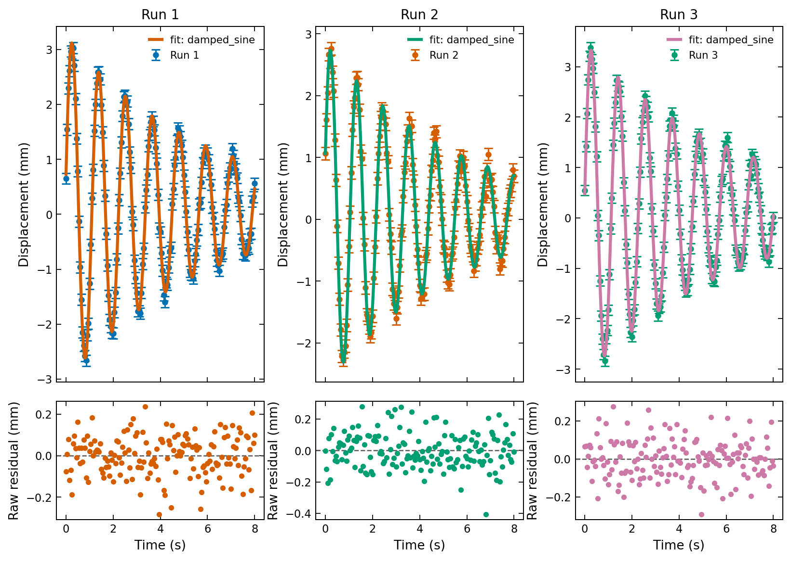

Run 2 has an unusually large chi-square for its stated noise, even though its observations were generated from the stated model. Such fluctuations can occur. In a real experiment this would prompt careful checks of the measurements and model, rather than automatic rejection or error rescaling.

The fitted frequencies and damping rates differ across runs, as expected from
the generating settings. Parameter errors describe uncertainty within each
run's model; they do not automatically include variability between experiments.

To assess a difference between independently estimated frequencies, a first
approximation is

$$
s_{f_1-f_2}=\sqrt{s_{f_1}^2+s_{f_2}^2}.
$$

That expression assumes independence between the estimates. A common clock
calibration or shared systematic could invalidate it. Real repeats may also
contain experimental variation that is larger than the fitted noise model.

## Interpret residuals and sampling

A repeated wave pattern in residuals can indicate the wrong frequency or a
missing mode. A slow drift can indicate a moving equilibrium. Large early-time
residuals may suggest the damping law is inadequate.

The evenly spaced time points make the FFT recipe convenient here. For
irregularly sampled data, do not pass an average time spacing into this recipe
and expect the same interpretation. Use a starting estimate appropriate to
the actual sampling or inspect the oscillations directly.

The model's fitted phase also depends on the time origin. Shifting time zero
changes phase, so phase comparisons require a consistent reference.

**Laboratory lesson:** distinguish the uncertainty of a fitted parameter in one
run from reproducibility across runs. Plotting several experiments together
helps reveal both, but it does not merge their statistical models.

# Complex example 5: overlapping spectral peaks

## Question and custom model

A spectrum contains two partly overlapping peaks and a background. We ask:
**can the data distinguish their centres, and how precisely can we measure
their separation?**

A single broad peak can resemble two narrow components. The difficulty is
therefore both numerical and statistical: a converged optimisation may still
leave strong parameter correlations.

The observations use absolute wavelengths from 548 to 553 nm. Define an offset
$u=\lambda_{\mathrm{wavelength}}-550$ nm and model

$$
I(u)=
A_1\exp\left[-\frac{(u-c_1)^2}{2w_1^2}\right]
+A_2\exp\left[-\frac{(u-c_2)^2}{2w_2^2}\right]+mu+b.
$$

| Parameters | Meaning | Unit |
| --- | --- | --- |
| `A1`, `A2` | Peak heights above baseline | mV |
| `c1`, `c2` | Centre offsets from 550 nm | nm |
| `w1`, `w2` | Gaussian widths | nm |
| `m` | Background slope | mV/nm |
| `b` | Background at 550 nm | mV |

The 201 synthetic observations use peaks $(A_1,c_1,w_1)=(2.5,-0.1,0.43)$ and
$(A_2,c_2,w_2)=(1.8,0.8,0.52)$, with background slope 0.06 mV/nm and intercept
0.35 mV. Noise is independent Gaussian with standard deviation 0.055 mV; the
seed is 505.

The first rows of [the overlapping-peak CSV](data/double_peak.csv) are:

| x | y | sigma |
| --- | --- | --- |
| 548 | 0.300096 | 0.055 |
| 548.025 | 0.162814 | 0.055 |
| 548.05 | 0.256456 | 0.055 |
| 548.075 | 0.145247 | 0.055 |
| 548.1 | 0.223257 | 0.055 |

## Define the function

LabFit accepts a custom callable. The first argument supplies x; subsequent
named arguments are fitted parameters. Return an array with the same shape
as the input.

~~~python
def double_peak(
    u: np.ndarray, A1: float, c1: float, w1: float, A2: float, c2: float, w2: float, m: float, b: float
) -> np.ndarray:
    first = A1 * np.exp(-0.5 * ((u - c1) / w1) ** 2)
    second = A2 * np.exp(-0.5 * ((u - c2) / w2) ** 2)
    return first + second + m * u + b
~~~

Working in offsets keeps the centre and baseline parameters near the measured
scales. A large absolute wavelength multiplied by a background slope can make
an intercept harder to interpret and introduce avoidable numerical coupling.
The transformation changes coordinates, rather than the underlying spectrum.

An absolute centre is $550+c_i$ nm. In this exercise the reference 550 nm is
exact. If a real reference wavelength has uncertainty, incorporate that
calibration error when reporting absolute centres.

## Break label symmetry and try several starts

Without a convention, swapping the two Gaussian components gives the same
total spectrum. Separate centre bounds label the left and right peaks.

The selected windows express the observed regions of interest. They also
encode a scientific assumption that one peak belongs in each region. If that
assumption is unsupported, a broader search and stronger model assessment
would be needed.

Three starting configurations explore different widths and centres within
these windows. The provisional background and amplitude scale come from
observations, while the centre choices span visible features.

~~~sh
python examples/tutorial/example_05_double_peak.py
~~~

~~~python
measured = load_csv(data / "double_peak.csv")
u = measured.x - 550.0
edge = (u < -1.2) | (u > 2.2)
slope, baseline = np.polyfit(u[edge], measured.y[edge], 1)
peak_height = float(np.max(measured.y - slope * u - baseline))
candidates = []
starts = [(-0.35, 0.65, 0.35), (0.0, 1.0, 0.55), (-0.2, 0.9, 0.75)]
for left, right, width in starts:
    candidate = fit(
        u,
        measured.y,
        sigma=measured.sigma,
        model=double_peak,
        absolute_sigma=True,
        p0={
            "A1": 0.7 * peak_height,
            "c1": left,
            "w1": width,
            "A2": 0.5 * peak_height,
            "c2": right,
            "w2": width,
            "m": float(slope),
            "b": float(baseline),
        },
        bounds={
            "A1": (0, 10),
            "A2": (0, 10),
            "c1": (-0.6, 0.25),
            "c2": (0.4, 1.5),
            "w1": (0.15, 1.2),
            "w2": (0.15, 1.2),
        },
    )
    candidates.append(candidate)
valid = [r for r in candidates if r.success and r.identifiable]
if not valid:
    raise RuntimeError("No reliable overlapping-peak fit; inspect starts and bounds.")
result = min(valid, key=lambda r: r.reduced_chi2)
~~~

Only converged, locally identifiable candidates are eligible. The candidates
use the same observations, noise model, number of parameters and bounds, so
minimising reduced chi-square here is equivalent to selecting the smallest
least-squares objective among these starts.

The resulting reduced chi-square values are:

| Starting configuration | Reduced chi-square |
| --- | --- |
| 1 | 1.07902 |
| 2 | 1.07902 |
| 3 | 1.07902 |

Agreement provides useful evidence of stability across these starts. It does
not prove that the global optimum is unique or that two physical emitters
must exist.

## Inspect the fitted components

| Parameter | Estimate | Standard error | Unit |
| --- | --- | --- | --- |
| `A1` | 2.49563 | 0.101 | mV |
| `c1` | -0.109203 | 0.0162 | nm |
| `w1` | 0.425249 | 0.00791 | nm |
| `A2` | 1.81207 | 0.0591 | mV |
| `c2` | 0.790328 | 0.034 | nm |
| `w2` | 0.524648 | 0.0182 | nm |
| `m` | 0.0638161 | 0.00336 | mV/nm |
| `b` | 0.352471 | 0.00705 | mV |

Degrees of freedom: **193**; reduced chi-square: **1.079**; chi-square p-value: **0.2146**. Converged: **True**; identifiable: **True**.

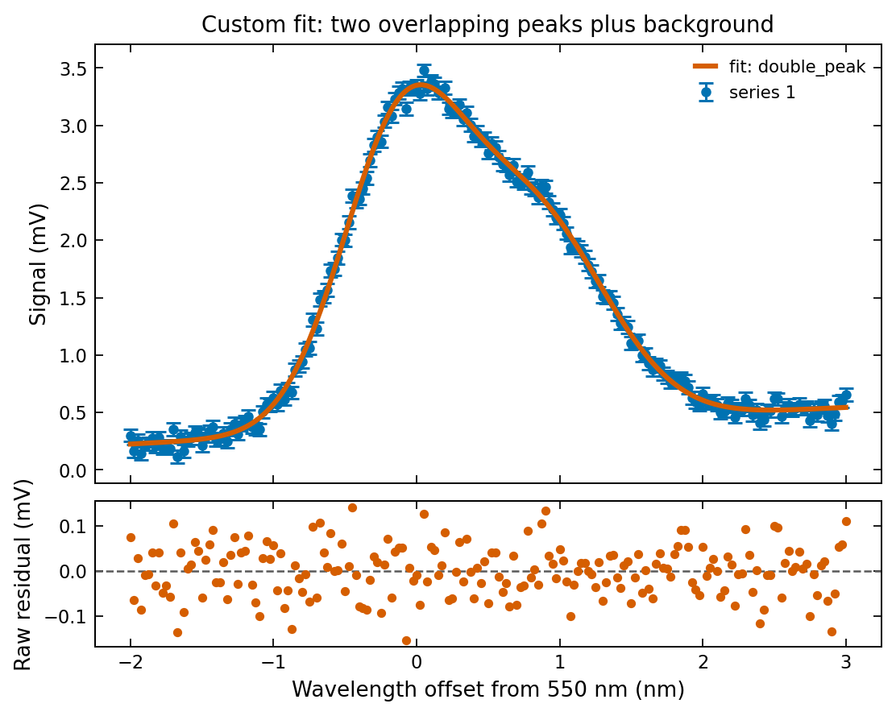

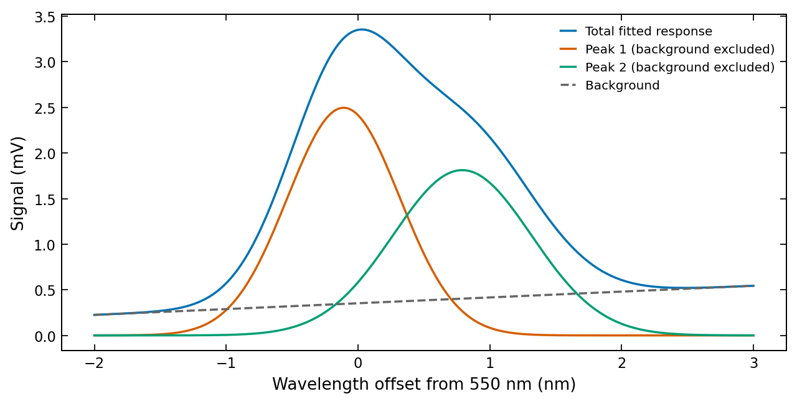

Component curves are model-derived contributions. They are not separately
measured spectra. Their apparent precision depends on the model and the
information available in the overlap region.

## Inspect parameter correlations

For fitted parameters $\theta_i$ and $\theta_j$, define

$$
\rho_{ij}=
\frac{(C_\theta)_{ij}}
{\sqrt{(C_\theta)_{ii}(C_\theta)_{jj}}}.
$$

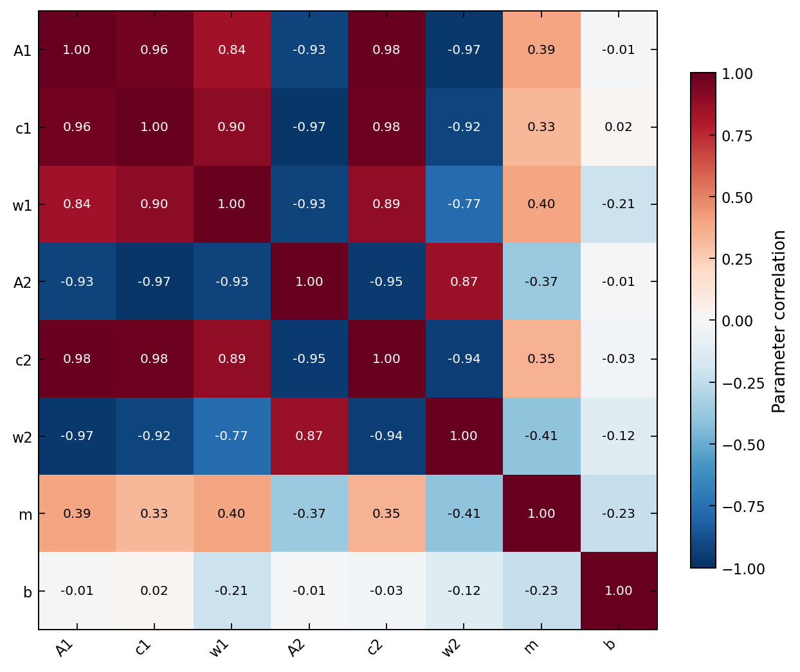

A large correlation is not automatically a failed fit. It explains why
uncertainty in a derived combination may differ substantially from the sum
of isolated parameter-error contributions.

Inspect `result.jacobian_rank` and `result.jacobian_condition` alongside
`identifiable`. LabFit normalises Jacobian columns for its condition
diagnostic, reducing dependence on the units of individual parameters.
These are local checks; a nonlinear model may also have distant alternatives.

## Propagate the peak separation

The peak separation is

$$
\Delta=c_2-c_1,\qquad
s_\Delta^2=s_{c_1}^2+s_{c_2}^2-2\,\mathrm{Cov}(c_1,c_2).
$$

The shared reference wavelength cancels from the difference. For absolute
centres it would remain relevant, but an exact common coordinate shift does
not change separation.

~~~python
names = ("c1", "c2")
indices = [result.param_names.index(name) for name in names]
centre_covariance = result.covariance[np.ix_(indices, indices)]
separation, separation_error = propagate_errors(
    lambda c1, c2: c2 - c1,
    jacobian=lambda c1, c2: np.array([-1.0, 1.0]),
    covariance=centre_covariance,
    c1=result.params["c1"],
    c2=result.params["c2"],
)
~~~

| Derived quantity | Estimate | Standard error | Unit |
| --- | --- | --- | --- |
| Peak separation | 0.899532 | 0.0183 | nm |

The extracted covariance follows the order $(c_1,c_2)$, matching both function
arguments and the gradient $(-1,1)$.

**Laboratory lesson:** overlapping components need more than a successful
optimiser status. Use defensible bounds, compare starting values, inspect
correlations and propagate the uncertainty of the quantity you actually need.

# Complex example 6: correlated thermal measurements

## Question and response model

A sensor warms toward a new equilibrium after a temperature step. Nearby
readings share a fluctuating instrumental component. We ask:
**what time constant describes the response when measurement errors are
correlated?**

Use LabFit's `exponential_rise` model:

$$
T(t)=T_0+A\left[1-\exp(-t/\tau)\right].
$$

| LabFit name | Meaning | Unit |
| --- | --- | --- |
| `amplitude` | Change from initial to final temperature | degree C |
| `tau` | Response time constant | s |
| `offset` | Initial temperature | degree C |

The asymptotic temperature is `offset + amplitude`. At $t=\tau$, the
temperature has completed $1-\exp(-1)$, about 63 percent, of its total rise.

There are 81 observations over 0 to 120 seconds. The generator uses amplitude
12 degrees C, time constant 28 s and initial temperature 21 degrees C.
Seed 606 controls the Gaussian noise draw.

The first rows of [the thermal CSV](data/thermal.csv) are:

| x | y | sigma |
| --- | --- | --- |
| 0 | 21.0542 | 0.208806 |
| 1.5 | 21.9012 | 0.208806 |
| 3 | 22.4545 | 0.208806 |
| 4.5 | 23.0992 | 0.208806 |
| 6 | 23.6504 | 0.208806 |

## Supply measurement covariance

The measurement covariance uses an exponentially decaying correlation plus
independent instrument noise:

$$
(C_y)_{ij}=s_c^2\rho^{|i-j|}+s_n^2\delta_{ij},
\qquad s_c=0.20,\ s_n=0.06,\ \rho=0.78.
$$

The standard deviations are in degrees C, so covariance entries are in
degrees C squared. The Kronecker delta $\delta_{ij}$ is one on the diagonal
and zero elsewhere.

The CSV's `sigma` column gives marginal standard deviations,
$\sqrt{(C_y)_{ii}}$, for inspection and for the intentionally simplified
comparison fit. The full matrix is supplied separately in
[the covariance CSV](data/thermal_covariance.csv).

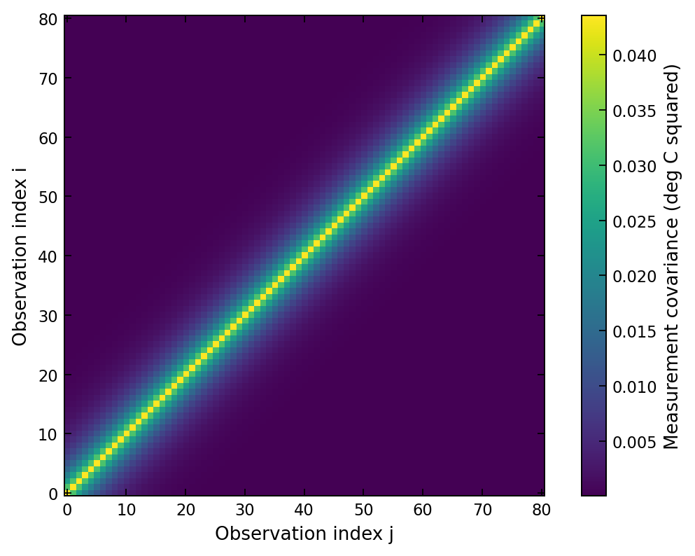

Covariance rows and columns correspond exactly to the observation order in
the measurement CSV. If you select or reorder observations, apply the same
selection or permutation to both covariance axes. Sorting the data alone
changes the stated error model.

LabFit requires a finite, symmetric, positive-definite measurement covariance.
An invalid or singular matrix is rejected before optimisation. A covariance
matrix has physical and statistical meaning; adding an arbitrary diagonal
term solely to avoid an error needs justification.

## Fit with and without correlations

~~~sh
python examples/tutorial/example_06_correlated.py
~~~

~~~python
series = load_csv(data / "thermal.csv", label="Thermal step response")
covariance = np.loadtxt(data / "thermal_covariance.csv", delimiter=",")
initial = {"amplitude": float(series.y[-1] - series.y[0]), "tau": 30.0, "offset": float(series.y[0])}
bounds = {"amplitude": (0, 30), "tau": (1, 200), "offset": (10, 30)}
correlated = fit(
    series.x,
    series.y,
    sigma_cov=covariance,
    model="exponential_rise",
    p0=initial,
    bounds=bounds,
    absolute_sigma=True,
)
diagonal = fit(
    series,
    model="exponential_rise",
    p0=initial,
    bounds=bounds,
    absolute_sigma=True,
)
cholesky = np.linalg.cholesky(covariance)
whitened = solve_triangular(cholesky, correlated.residuals, lower=True)
chi2_from_residuals = float(whitened @ whitened)
~~~

The correlated fit passes only `sigma_cov`; it does not also pass scalar
sigmas. The diagonal comparison uses the CSV's marginal sigmas and assumes
independent errors. Both fits use the same response model, starting values,
bounds and absolute covariance policy.

The initial amplitude comes from the observed change. The 30-second starting
time constant is a rough scale from the visible rise, and the initial offset
comes from the first observation.

### Generalized least-squares result

| Parameter | Estimate | Standard error | Unit |
| --- | --- | --- | --- |
| `amplitude` | 11.7661 | 0.203 | degree C |
| `tau` | 27.3101 | 1.14 | s |
| `offset` | 21.1233 | 0.192 | degree C |

Degrees of freedom: **78**; reduced chi-square: **0.8221**; chi-square p-value: **0.8709**. Converged: **True**; identifiable: **True**.

### Diagonal-error comparison

| Parameter | Estimate | Standard error | Unit |
| --- | --- | --- | --- |
| `amplitude` | 11.7381 | 0.0934 | degree C |
| `tau` | 27.7915 | 0.535 | s |
| `offset` | 21.1972 | 0.0995 | degree C |

Degrees of freedom: **78**; reduced chi-square: **0.8889**; chi-square p-value: **0.7478**. Converged: **True**; identifiable: **True**.

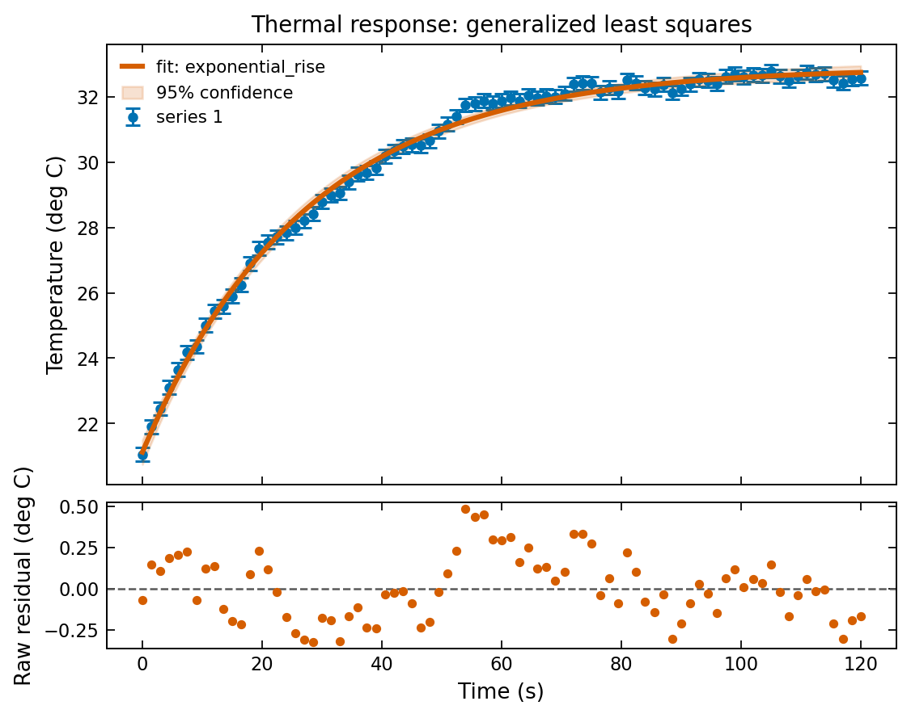

The ratio of time-constant standard errors, correlated fit divided by
diagonal fit, is **2.13042**.
For this dataset the correlated analysis reports a larger uncertainty in
the time constant. Repeated adjacent readings provide less independent
information than the diagonal model assumes.

Correlation does not inflate every uncertainty by a universal factor. Its
effect depends on the covariance pattern and on which parameter combination
the data constrain. Estimates themselves can also change because the
weighting geometry changes.

## Whiten the residuals

Generalized least squares minimises

$$
\chi^2=\boldsymbol{r}^T C_y^{-1}\boldsymbol{r}.
$$

A Cholesky factor $L$ satisfies $C_y=LL^T$. Define whitened residuals by
solving $L\boldsymbol{z}=\boldsymbol{r}$:

$$
\boldsymbol{z}=L^{-1}\boldsymbol{r},\qquad
\chi^2=\boldsymbol{z}^T\boldsymbol{z}.
$$

Use a triangular solve rather than explicitly forming the matrix inverse.
The squared norm computed by the script is
**64.1204**. Multiplying LabFit's
reported reduced chi-square by its degrees of freedom gives
**64.1204**. Their agreement checks that
the diagnostic uses the same covariance as the fit.

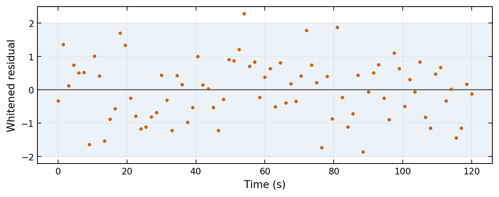

Whitening transforms the noise coordinates. The plotted time identifies
observation order, but each whitened coordinate can combine information from
several preceding observations. As with ordinary fitted residuals, parameter
estimation imposes constraints; do not treat every whitened fitted residual
as an independent, unconstrained Gaussian draw.

The chi-square p-value from the diagonal comparison assumes independent
errors. Since that assumption is false for this experiment, its numerical
value should not be interpreted as a calibrated model-assessment probability.

## Future observations need their own noise model

A confidence band for the mean can use the fitted parameter covariance.
A prediction band additionally needs an error model for the future
observation. The training covariance describes the existing observations,
rather than an arbitrary new measurement.

LabFit therefore requires explicit `prediction_sigma` for a prediction
band with correlated training errors. Its prediction calculation assumes
the future error is independent of the fitted data. If the new reading shares
the same instrumental fluctuation, a marginal sigma alone does not describe
that dependence; a joint prediction calculation would be needed.

**Laboratory lesson:** many closely spaced observations are not necessarily
many independent measurements. Preserve covariance through fitting,
diagnostics and interpretation.

# Reporting and troubleshooting

## A defensible report

A useful analysis report contains the scientific question, equation and
parameter units; the observation source and preprocessing; the uncertainty
specification; starting values and bounds for nonlinear fits; fitted
estimates with errors; residual plots; and a discussion of model limitations.

Report a derived quantity when it directly answers the scientific question.
For example, peak separation may be more relevant than eight individual
parameters. Keep full covariance and numerical precision in machine-readable
output, then round estimates and errors sensibly for readers.

Avoid reporting long strings of digits as physical precision. A conventional
final laboratory summary rounds an uncertainty to one or two significant
figures and rounds its estimate to the corresponding decimal place. The
computed tables retain extra digits to support reproduction.

These examples intentionally keep model selection modest. They do not
demonstrate robust regression, Poisson maximum likelihood, bootstrap
intervals, simultaneous bands or errors-in-variables fitting. Those methods
may be appropriate when the assumptions of this workflow fail.

## Troubleshooting guide

| Symptom | Check | Useful next step |
| --- | --- | --- |
| Fit does not converge | Starting values, units, bounds, model domain | Plot the starting curve; choose a physically sensible scale |
| Converged fit leaves structured residuals | Missing baseline, curvature, second component or drift | Revise the model based on experimental knowledge |
| NaN parameter errors | Identifiability and degrees of freedom | Remove redundant parameters or collect more informative data |
| Very large reduced chi-square | Model inadequacy, bad data or underestimated errors | Inspect residuals and measurement procedure |
| Very small reduced chi-square | Error scale, overfitting, chance fluctuation | Revisit errors; avoid automatic rescaling |
| Covariance rejected | Shape, ordering, finiteness, symmetry and positive definiteness | Correct the covariance model or file alignment |
| Missing uncertainty warning | CSV columns and inference provenance | Supply calibrated errors or choose explicit unweighted loading |
| Unexpected peak labels | Interchangeable components | Use defensible centre windows or a clear labelling convention |

A zero measurement sigma is invalid because it would claim infinite precision.
To exclude observations explicitly, use an appropriate data mask or zero
inverse-variance weights. Document exclusion decisions; removing inconvenient
residuals can bias both the fit and its apparent goodness-of-fit.

Nonpositive degrees of freedom make residual-scale diagnostics unavailable.
More observations can help, but simply increasing the number of nearly
identical or heavily correlated measurements may add little new information.

## Compact API reference

### Loading and fitting

~~~python
from labfit import DataSeries, Fitter, fit, fit_multi
from labfit.io import load_csv

series = load_csv("measurements.csv", label="Experiment")
result = fit(series, model="linear", absolute_sigma=True)

# Equivalent array interface
result = fit(x, y, model="linear", sigma=errors, absolute_sigma=True)

# Covariance interface: supply covariance, without another error specification
result = fit(x, y, model="linear", sigma_cov=C_y, absolute_sigma=True)

# Reusable model configuration
fitter = Fitter(model="linear")
result = fitter(series, absolute_sigma=True)
~~~

Model names select built-in functions; a callable provides a custom model.
`p0` can map parameter names to starting values. `bounds` can map names to
lower/upper tuples, using `None` for an unbounded side. Initial values
must lie inside the supplied bounds.

### Reading results

| Attribute or method | Meaning |
| --- | --- |
| `params` | Parameter-name to fitted-value mapping |
| `uncertainties` | Parameter-name to standard-error mapping |
| `param_names` | Order of rows/columns in parameter covariance |
| `covariance` | Local fitted-parameter covariance |
| `predict(x)` | Model predictions at supplied x values |
| `residuals` | Observations minus fitted predictions |
| `success`, `message` | Optimiser status and explanation |
| `identifiable` | Local reliability of separating the parameters |
| `jacobian_rank`, `jacobian_condition` | Local Jacobian diagnostics |
| `dof`, `reduced_chi2`, `p_value` | Degrees of freedom and weighted diagnostics |
| `residual_variance` | Raw residual scatter per positive degree of freedom |
| `series` | Data and actual uncertainty specification used in fitting |

### Plotting and propagation

~~~python
from labfit import plot_fit, plot_multi_fit
from labfit.utils import propagate_errors

plot = plot_fit(result, show_residuals=True, xlabel="Time (s)", ylabel="Signal (V)")
plot.save("fit.png")

plot = plot_fit(result, show_ci=True, ci_level=0.95)
plot = plot_fit(result, show_ci=True, prediction=True,
                ci_level=0.95, prediction_sigma=0.1)

value, error = propagate_errors(
    derived_function, jacobian=gradient_function,
    covariance=parameter_covariance, parameter_a=a, parameter_b=b,
)
~~~

`prediction_sigma` can be a scalar or a function of the plotted x grid.
For varying future errors, use a function rather than reusing a training
array with a different shape. Match the future-noise units to y.

For propagation, provide parameter values in the same order represented by
the covariance and returned gradient. The names in the final generic
example must match the arguments of your derived function.

# Reproduce, inspect and adapt

## Recreate the observations

The supplied CSV files are sufficient to run all examples. Regenerate them
only when you explicitly want to recreate the synthetic experiment:

~~~sh
python examples/tutorial/generate_data.py
~~~

The generator stores its true parameters and noise model in
[the manifest](data/manifest.json). Each dataset has a fixed random seed.
The thermal covariance is written with extra precision to preserve symmetry
and numerical properties.

For a separate output directory:

~~~sh
python examples/tutorial/generate_data.py --output path/to/data
python examples/tutorial/run_examples.py --data path/to/data --output path/to/results
~~~

The second command saves computed results and both figure formats in the
chosen output directory. It does not alter the observations.

## Rebuild Markdown, LaTeX and PDF

The document builder executes the examples using the supplied data, inserts
code and results into one authored Markdown template, and converts that
document to LaTeX. Pandoc handles conversion; Tectonic compiles the PDF.

~~~sh
python examples/tutorial/build_tutorial.py
~~~

Install Pandoc and Tectonic from their official distributions if they are
not available. A bundled Codex Tectonic is detected when present. You can
also choose the executable explicitly:

~~~sh
python examples/tutorial/build_tutorial.py --tectonic /path/to/tectonic
python examples/tutorial/build_tutorial.py --markdown-only
~~~

The Markdown-only option needs the normal Python dependencies and creates
the same analysis figures and result tables. It does not require the two
document executables.

To edit the tutorial, change `tutorial.template.md`, the example scripts or
`style.tex`, then rebuild. Generated Markdown and LaTeX are deliverables
rather than separate authoring sources. Keep the `figures/` directory
beside the LaTeX source when compiling it.

## What the checks establish

The integration checks regenerate the data in a temporary directory and
compare CSV contents. They verify that measurement covariance is positive
definite and aligned with marginal sigmas. They execute all six analyses
and check convergence, local identifiability and finite uncertainties.

Recovery of synthetic truth is assessed with explicit tolerances: five
estimated standard errors plus a small absolute numerical floor. This is
a broad regression guard, rather than a requirement that every estimate lie
within one standard error. The seeds are fixed without selecting them for
especially favourable diagnostics.

The checks also verify the covariance contribution to peak-separation
uncertainty and the agreement between generalized least-squares chi-square
and the squared norm of whitened residuals. The deliberately incomplete
background-free model must retain its conspicuously worse diagnostic.

The document checks ensure that referenced files exist and template
placeholders have been resolved. The PDF is compiled and rendered for
visual inspection of code, tables, plots and page transitions.

~~~sh
python -m pytest tests/test_tutorial.py -q
~~~

These checks support reproducibility and catch common implementation errors.
They do not establish that the model assumptions are suitable for an
unseen real experiment.

## Adapt the workflow to your experiment

Start by replacing one CSV with your observations and explicit errors.
Confirm the column units, shape and ordering. Plot the observations before
choosing starting values. Write the simplest model supported by the
experimental mechanism, then inspect its residuals before interpreting
parameter errors.

If you add a derived quantity, write its formula, identify which fitted
parameters it depends on, and extract covariance in that same order.
If you add a covariance matrix, preserve observation alignment through
every selection step.

The tutorial's complete analyses are available as:

- [Linear calibration](example_01_calibration.py)
- [Exponential decay](example_02_decay.py)
- [Single peak with background](example_03_single_peak.py)
- [Repeated damped oscillations](example_04_oscillators.py)
- [Overlapping peaks](example_05_double_peak.py)
- [Correlated thermal response](example_06_correlated.py)

For further API details, consult the repository's documentation:
[quickstart](../../docs/quickstart.rst), [concepts](../../docs/concepts.rst)
and [fitting functions](../../docs/fitting-functions.rst). The material in
this tutorial is implemented against the current checkout, so the executable
examples remain the direct reference for these demonstrations.

